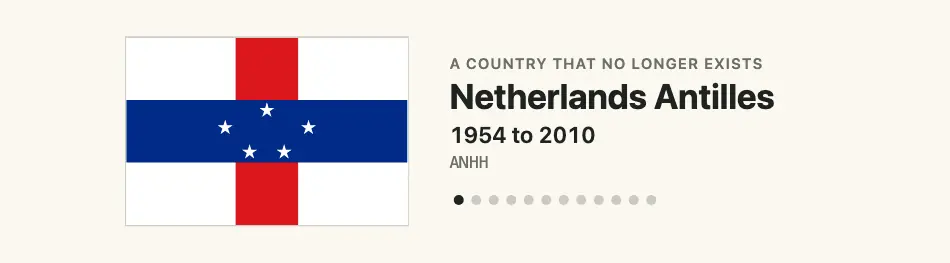
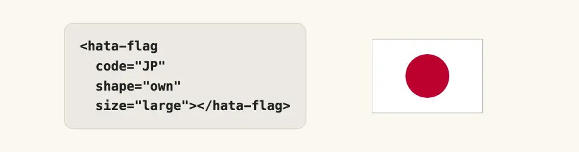
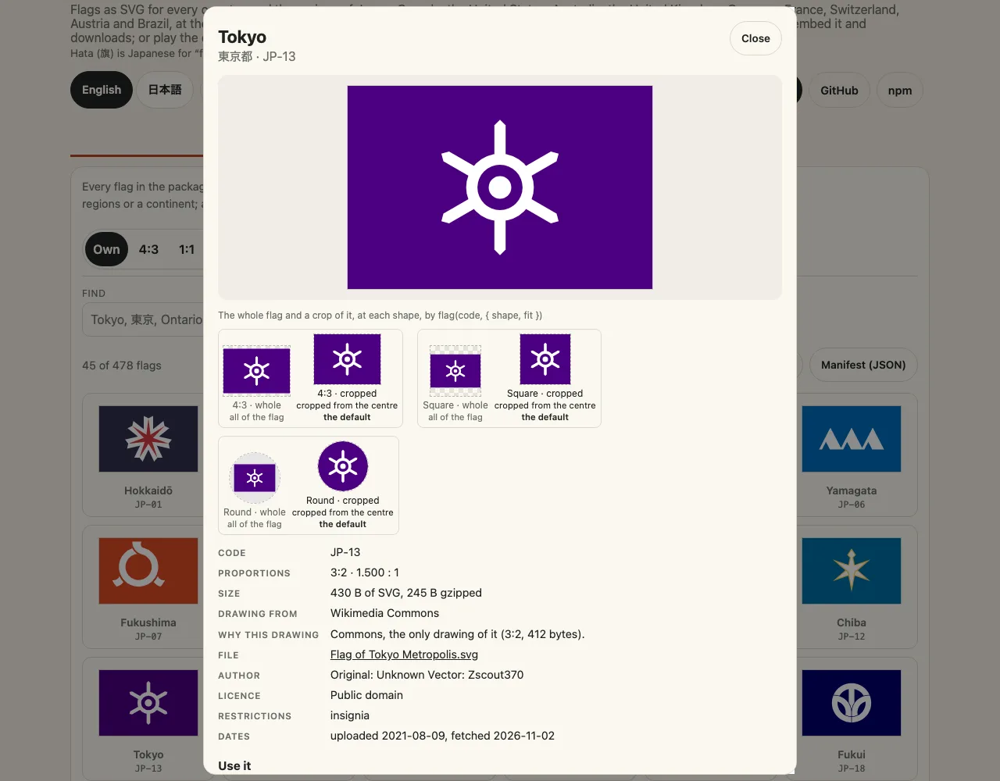
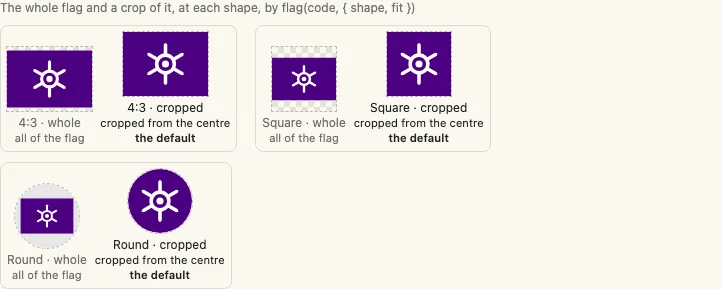

<p align="center"><a href="https://johnmorrisdotca.github.io/hata/"><picture><source media="(prefers-color-scheme: dark)" srcset="https://raw.githubusercontent.com/johnmorrisdotca/hata/main/docs/images/thumbnail-dark.png"></picture></a></p>

<h1 align="center">Hata <sub>旗</sub> — Country and region flags as SVG</h1>

<p align="center"><strong>Hata 旗: flags as SVG for every country, and the regions of Japan, Canada, the United States, Australia, the United Kingdom, Germany, France, Switzerland, Austria and Brazil, keyed by ISO 3166 code.</strong><br>
At their true proportions, optimised and safe to inline, with the source, author and licence of every flag. One module per flag, a lookup that loads one by its code, frames for 4:3, square and round that never stretch or misrepresent a flag, and a <code>&lt;hata-flag&gt;</code> element to embed one anywhere. Zero dependencies.</p>

<p align="center" lang="ja">世界の国々と、日本・カナダ・アメリカ・オーストラリア・イギリス・ドイツ・フランス・スイス・オーストリア・ブラジルの地域の旗を、本来の縦横比の SVG で収録し、ISO 3166 のコードで引けるようにした、依存関係のない TypeScript パッケージです。</p>

<p align="center">
  <a href="https://github.com/johnmorrisdotca/hata/actions/workflows/ci.yml"></a>
  <a href="https://www.npmjs.com/package/@johnmorrisdotca/hata"></a>
  <a href="./LICENSE"></a>
  
  <a href="https://johnmorrisdotca.github.io/hata/docs/api/main/index.html"></a>
  
  <a href="https://www.npmjs.com/package/@johnmorrisdotca/hata#provenance"></a>
</p>

<p align="center"><a href="https://johnmorrisdotca.github.io/hata/"><strong>Try it →</strong></a> · <a href="https://johnmorrisdotca.github.io/hata/builder.html">Build a flag</a> · <a href="https://johnmorrisdotca.github.io/hata/docs/index.html">Documentation</a> · <a href="https://johnmorrisdotca.github.io/hata/docs/guides/getting-started.html">Getting started</a> · <a href="https://johnmorrisdotca.github.io/hata/api.html">API reference</a></p>

<table align="center">
<tr>
<td align="center" valign="top">
<picture>
<source media="(prefers-color-scheme: dark)" srcset="https://raw.githubusercontent.com/johnmorrisdotca/hata/main/docs/images/hero-desk-dark.webp">

</picture>
<br><em>The gallery on a desk: every flag at its own proportions, found by name or code.</em>
</td>
<td align="center" valign="top">
<picture>
<source media="(prefers-color-scheme: dark)" srcset="https://raw.githubusercontent.com/johnmorrisdotca/hata/main/docs/images/quiz-phone-dark.webp">

</picture>
<br><em>The quiz on a phone, in Japanese, after a wrong answer.</em>
</td>
</tr>
</table>

Hata is the flag set a site that already knows its countries and regions by ISO code (from [Kuni](https://github.com/johnmorrisdotca/kuni), say) can show beside them: 479 flags, every one drawn at the proportions its government gives it, as an SVG that scales to any size and looks the same on every system, which a flag emoji does not (Windows shows two letters). No other flag set has Japan's prefectures, all of Canada's provinces and territories, Germany's and Austria's states, Switzerland's cantons and Brazil's states together, or codes that match ISO 3166-2. Each flag is a module of its own, so a page carries only the flags it imports; one lookup loads any flag by its code when it is wanted. And every flag says where it comes from: the Wikimedia Commons file or the flag set it was drawn from, its author, its licence, and why that drawing was chosen. It works in [the demo](https://johnmorrisdotca.github.io/hata/) with nothing to install.

<picture>
<source media="(prefers-color-scheme: dark)" srcset="https://raw.githubusercontent.com/johnmorrisdotca/hata/main/docs/images/hero-phone-dark.webp">

</picture>
<br><em>The gallery header and filters on a phone, in Japanese.</em>

## The best of it

- **Round and square frames that never stretch a flag.** `frame()` and `flag(code, { shape })` put a flag in a 4:3, square or round frame, cropped only where a crop keeps every colour, and drawn again for the shape where flag-icons has done so ([frames](#3-frames-that-never-stretch-and-never-misrepresent)).

<p align="center">
<picture>
<source media="(prefers-color-scheme: dark)" srcset="https://raw.githubusercontent.com/johnmorrisdotca/hata/main/docs/images/frames-live-desk-dark.webp">

</picture>
<br><em>Flags through the frames: their own proportions, 4:3, square and round, never stretched.</em>
</p>

- **Every province and territory of Canada**, and the regions of nine other countries: 13 of 13 here, keyed by ISO 3166-2 (`CA-BC`, `CA-ON`).

<p align="center">
<picture>
<source media="(prefers-color-scheme: dark)" srcset="https://raw.githubusercontent.com/johnmorrisdotca/hata/main/docs/images/provinces-desk-dark.webp">

</picture>
<br><em>Canada's thirteen, in round frames, each loaded by its code.</em>
</p>

- **Former countries that a medal table still names**: the Soviet Union, East and West Germany, Czechoslovakia, Yugoslavia and seven more, with their years ([below](#former-countries)).

<p align="center">
<picture>
<source media="(prefers-color-scheme: dark)" srcset="https://raw.githubusercontent.com/johnmorrisdotca/hata/main/docs/images/former-desk-dark.webp">

</picture>
<br><em>Twelve countries that no longer exist, each under a code no present-day country uses.</em>
</p>

- **`<hata-flag>`, one tag in any page**: change `code`, `shape` or `size` and the flag follows, with no framework and no bundler ([embed it](#4-embed-it-anywhere)).

<p align="center">
<picture>
<source media="(prefers-color-scheme: dark)" srcset="https://raw.githubusercontent.com/johnmorrisdotca/hata/main/docs/images/element-desk-dark.webp">

</picture>
<br><em>The same tag with a different code and shape.</em>
</p>

## In 30 seconds

```sh
npm install @johnmorrisdotca/hata
```

```ts
import japan from "@johnmorrisdotca/hata/flags/jp";     // one flag, one module: 158 bytes
import { flag } from "@johnmorrisdotca/hata/load";

element.innerHTML = japan;                             // an <svg> with a viewBox: it fills its box, never stretched
const tokyo = await flag("JP-13");                     // any flag by its code, loaded when asked
const round = await flag("ca", { shape: "round", label: "Canada" }); // drawn for the circle, red bars and all
await flag("XX");                                      // null: not a code with a flag
```

```html
<script type="module" src="https://cdn.jsdelivr.net/npm/@johnmorrisdotca/hata@1/dist/element-define.js"></script>
<hata-flag code="DE-BY" shape="round" size="48"></hata-flag>
```

Install the scoped name: an unscoped `hata` on npm is somebody else's package.

## Who it is for

- **Forms and profiles** that show where somebody is from.
- **Sites rendered on a server**, which need a flag as a string, with no network and no DOM.
- **Japanese-language sites** that need the 47 prefectures' flags, and Canadian, American, Australian, British,
  German, French, Swiss, Austrian and Brazilian ones that need their regions' flags, keyed the same way as their
  countries.
- **Any page at all**, with one script tag and a `<hata-flag>`, or an iframe.
- **Maps, quizzes and games**, with flags as square tiles or round markers, never stretched.
- **Anybody who has to say where a picture came from**: every flag has its source, author and licence in the manifest.

## Features

<picture>
  <source media="(prefers-color-scheme: dark)" srcset="https://raw.githubusercontent.com/johnmorrisdotca/hata/main/docs/images/detail-desk-dark.webp">
  
</picture>
<br><em>Tokyo’s detail panel keeps the drawing, frames and source together.</em>

<picture>
  <source media="(prefers-color-scheme: dark)" srcset="https://raw.githubusercontent.com/johnmorrisdotca/hata/main/docs/images/frames-desk-dark.webp">
  
</picture>
<br><em>Compare whole and cropped views at each supported frame shape.</em>

<picture>
  <source media="(prefers-color-scheme: dark)" srcset="https://raw.githubusercontent.com/johnmorrisdotca/hata/main/docs/images/provenance-desk-dark.webp">
  
</picture>
<br><em>Read the stored source, author, licence and drawing proportions.</em>


### What's in it

- **479 flags**: 246 of the 250 countries Kuni knows, 45 of Japan's 47 prefectures,
  13 of Canada's 13 provinces and territories, 57 of the United States' 57 states, district and outlying areas,
  8 of Australia's 8 states and territories, 3 of the United Kingdom's 4 countries, 16 of Germany's 16 states,
  17 of France's 26 regions and overseas collectivities, 26 of Switzerland's 26 cantons, 9 of Austria's 9 states
  and 27 of Brazil's 27 states and Federal District, and 12 former countries that a medal table or a record book
  still names (the Soviet Union, East and West Germany, Czechoslovakia, Yugoslavia, Serbia and Montenegro, and
  six more: [below](#former-countries)). The 26 codes with no flag are listed with their reasons.
- **Disputed and alternative flags, offered side by side.** A place with more than one flag in real use has them all,
  each with a status (official, de facto, historical or local), dates, the reason it is offered and a source, and a
  `disputed` mark where more than one authority claims the place's flag: Afghanistan's Republic tricolour and the
  Taliban's flag, Bavaria's lozenges and stripes, Northern Ireland's Union Flag and former Ulster Banner, Syria's
  flag before and after 2024-12-08, and each French territory's local flag. Hata takes no side
  and says why each default was chosen ([below](#disputed-and-alternative-flags)).
- **True proportions.** Japan's 2:3, Canada's 1:2, the United States' 10:19, Switzerland's square, Nepal's two
  pennants: each flag is shipped as its government draws it, and `frame()` puts it in a 4:3, square or round frame
  when that is what a layout needs, never stretched.
- **Frames that keep the flag, whole and cropped.** A crop from the centre would turn Canada's square into a white square
  with a leaf, so every flag is offered both ways, `fit: "whole"` and `fit: "crop"`, and `auto` takes the crop only where it
  shows the flag fairly: kept at the side a person chose for 121 flags (the United States' canton, Uruguay's Sun of May), from
  the centre where that keeps every colour, and the whole flag otherwise. The manifest says which, and why.
- **Embed it anywhere.** `<hata-flag>`, a custom element named for a screen reader in the page's language, an
  iframe page, and a builder in the demo that writes the code for an element, an `&lt;img&gt;`, an iframe, an ES module,
  React, Vue, Svelte or Angular.
- **The best accurate drawing.** Each flag's Commons drawing (the one Wikidata names) is compared in a browser with flag-icons',
  country-flag-icons' and circle-flags'; a set's drawing ships only where it is the same flag at the same proportions and smaller,
  or free where Commons' is not. Nothing is redrawn, and every shipped flag is proved to draw as its source does.
- **Safe to inline.** Scripts, event handlers, foreign objects and outside references are refused at build time, and every id and class
  carries the flag's own prefix, so two flags in one page cannot collide.
- **Small where it matters.** The main entry is 12 KB (3.7 KB gzipped) and carries no flag; the median flag is
  under 800 bytes; the lookup is 25 KB and then the flag's own file.
- **Provenance for every flag**, in `/manifest` and `manifest.json`: the file, its page, the Wikidata item, the
  licence, the author, the restrictions, and the dates.
- **Typed, documented, pure.** ESM with types; every export has a checked example; no dependencies, no network, no DOM.

## Use it in your project

The [flag builder](https://johnmorrisdotca.github.io/hata/builder.html) previews each choice and writes code for custom elements, images, iframes, framework components and website code blocks. Its link preserves the setup. See [embedding flags](./docs/embeds.md) for sizes, validated iframe parameters and event messages.

### Install

```sh
npm install @johnmorrisdotca/hata
# or: pnpm add @johnmorrisdotca/hata
# or: yarn add @johnmorrisdotca/hata
```

It ships ES modules with types; nothing has a side effect but `/element/define`, which registers `<hata-flag>`.
Node 24 can also `require()` it.

### Install under another name

```sh
npm install flags@npm:@johnmorrisdotca/hata
```

```ts no-check
import { flagCode } from "flags";
console.log(flagCode("jp-13"));
```

The alias changes only the import name in your project.

### The entry points

| Entry | What it carries | Size |
| --- | --- | --- |
| `@johnmorrisdotca/hata` | The codes, `flagCode`, `flagUrl`, `frame`, `aspectOf`, `toDataUri`; no flag | 12 KB, 3.7 KB gzipped |
| `@johnmorrisdotca/hata/flags/<code>` | One flag's SVG string (`/flags/jp`, `/flags/jp-13`, `/flags/ca-on`, `/flags/de-by`, and a former country's, `/flags/suhh`, lower case); `/flags/<code>.1x1` and `.4x3`, flag-icons' drawing made for that frame, where there is one | median 755 bytes; 176 bytes for Japan |
| `@johnmorrisdotca/hata/load` | `flag(code, { shape, fit, variant, date, role })`, one dynamic import per flag | 26 KB, 5.7 KB gzipped, then the flag's own file (and a 3.6 KB gzipped table when a frame is asked for, and a 0.5 KB one when a variant is) |
| `@johnmorrisdotca/hata/names` | `flagName(code, lang)` and `flagAspect(code)`: each flag's place in English and Japanese, from Kuni | 24 KB, 8.7 KB gzipped |
| `@johnmorrisdotca/hata/organisations` | Organisations' flags, by `org:` id | 1.2 KB gzipped |
| `@johnmorrisdotca/hata/search` | Each flag's colours (`coloursOf`) and tags (`tagsOf`), and the flags that have them (`flagsWith`) | 67 KB, 21 KB gzipped |
| `@johnmorrisdotca/hata/custom` | Flags the page registers (`custom:<slug>`) | 11 KB |
| `@johnmorrisdotca/hata/element` | `<hata-flag>`: `defineFlag`, `FLAG_ELEMENT_NAME`, `FLAG_ELEMENT_ATTRIBUTES` | 8 KB, 2.8 KB gzipped, then /load and /names |
| `@johnmorrisdotca/hata/element/define` | Registers `<hata-flag>` when imported (`dist/element-define.js` on a CDN) | a line, then /element |
| `@johnmorrisdotca/hata/manifest` | Every flag's source, licence, author and why it was chosen, how each frame is made, the flags in real use besides and the earlier flags of a country (`variantsOf`, `variantOn`), and the codes with no flag | 1,185 KB, 151 KB gzipped |
| `@johnmorrisdotca/hata/svg/<code>.svg` | Every flag as a file, for an `&lt;img&gt;`, a CSS `url()` or a CDN; `<code>.1x1.svg` and `.4x3.svg` too | the same as the module's string |
| `@johnmorrisdotca/hata/manifest.json` | The manifest as JSON | 848 KB |

### 1. One flag

```ts
import japan from "@johnmorrisdotca/hata/flags/jp";
import { svg as tokyo } from "@johnmorrisdotca/hata/flags/jp-13";
import bavaria from "@johnmorrisdotca/hata/flags/de-by";

element.innerHTML = japan;
```

Each flag's types carry a doc comment naming the place, its proportions, its size and its source, so an editor
shows which flag an import is.

### 2. Any flag by its code

```ts
import { flag, flagDataUri } from "@johnmorrisdotca/hata/load";

const svg = await flag(form.country);              // "JP", "jp", "JP-13", "ca_on": any case
image.src = (await flagDataUri("US-TX")) ?? "";    // ready for an image element
```

A code with no flag here, a malformed one, or anything that is not a code gives `null`, never a near miss. Only an
argument that is not a string throws.

### 3. Frames that never stretch, and never misrepresent

```ts
import { frame } from "@johnmorrisdotca/hata";
import { flag } from "@johnmorrisdotca/hata/load";
import canada from "@johnmorrisdotca/hata/flags/ca";

await flag("CA", { shape: "1:1" });                // flag-icons' square of Canada, drawn for the shape
frame(canada, { shape: "4:3" });                   // cropped from the centre: the crop keeps every colour
frame(canada, { shape: "1:1" });                   // the whole flag: a centre crop would lose the red bars
frame(canada, { shape: "1:1", fit: "cover" });     // the centre crop anyway, because you asked for it
frame(canada, { shape: "round", label: "Canada" }); // the whole flag on a neutral disc, with role="img" and a title

// Whole and cropped, for every flag: the crop is kept where a person judged the flag's meaning to be.
await flag("US", { shape: "1:1", fit: "whole" });  // all of the stars and stripes, in a square
await flag("US", { shape: "1:1", fit: "crop" });   // the canton and a slice of the stripes, not the middle stripes
frame(usa, { shape: "1:1" });                      // auto: the same crop, kept at the hoist
frame(usa, { shape: "1:1", fit: "whole" });        // the whole flag
```

#### Whole and cropped

Every flag is offered as the whole flag and as a crop, at 4:3, square and round. `fit: "whole"` (CSS's `contain`) shows
all of it. `fit: "crop"` crops it **at the side a person chose for that flag**, not at the middle: the United States and
Uruguay at the hoist, so that the canton or the Sun of May shows with a slice of the stripes; Rwanda at the fly, where its
sun is; flags with a triangle or a serrated edge, and the Nordic crosses, at the hoist. Where nobody chose a side the crop is from the
centre (Japan's disc, a coat of arms, a tricolour). `fit: "auto"`, the default, takes the crop where it shows the flag fairly and
the whole flag where it does not: a Blue Ensign has its Union Flag in one corner and its stars or badge in the other, and no square
holds both. A crop asked for by name always crops, even there. `manifest(code).framings[shape].crop` records, for every flag and
frame, which crop `auto` uses (`own`, `curated`, `centre` or `whole`), the side (`at`), the reason (`why`) and the colours a crop
drops (`loses`), and [docs/framing.md](./docs/framing.md) lists every flag with its side and reason. The demo's flag panel shows the
whole flag beside its crop at each shape, and the gallery has a Whole / Cropped switch.

`pnpm data:framing` measured every flag's frames in a browser. A frame keeps a flag when every colour covering 5% of it still covers at least half that share. For 4:3 and
square it takes, in order: the flag itself where it is that shape already; flag-icons' drawing made by hand for the shape, where it keeps the colours and draws the same design;
a crop kept at the chosen side or from the centre, where that keeps them; and the whole flag otherwise. Round is the square's choice in a circle. `flag(code, { shape })` uses
all of these; `frame(svg)` works on the one SVG it is given, as measured for the flag the SVG names (`data-hata`). `manifest(code).framings` says which for every flag, and a
browser test fails if any frame of any flag loses a colour no reason excuses.

### 4. Embed it anywhere

One script tag and an element, for any page:

```html
<script type="module" src="https://cdn.jsdelivr.net/npm/@johnmorrisdotca/hata@1/dist/element-define.js"></script>
<p>Where I live: <hata-flag code="CA-BC"></hata-flag> British Columbia</p>
<hata-flag code="JP-13" shape="round" size="48" border shadow></hata-flag>
```

| Attribute | What it does |
| --- | --- |
| `code` | The flag's code, in any case: `JP`, `jp-13`, `CA-ON`, `DE-BY` |
| `shape` | `own` (the default: its own proportions), `4:3`, `1:1` or `round`, framed as `flag(code, { shape })` frames it |
| `size` | Its height in CSS pixels; left out, `1em`, the height of the text around it, and any CSS height works |
| `variant` | Which of the place's flags in real use to draw, by its `id` from `variantsOf(code)`: `de-facto`, `stripes`, `local`; left out, the default |
| `date` | The day whose flag to draw, `"1962-09-29"`: the flag then (`variantOn`), the legal one by default; a `variant` wins |
| `which` | With `date`: `legal` (the default) or `in-use`, the flag flown in practice (not `role`, which is the ARIA role the element sets) |
| `allow-restricted` | Draw a flag the law restricts (Germany's of 1935 to 1945), for history and education; without it nothing is drawn, with `data-restricted` and the reason in `data-reason` |
| `fit` | `auto` (the default), `whole` (all of the flag), `crop` (a crop at the side chosen for the flag), `cover`, `hoist` or `contain`, as `frame()` takes them |
| `label` | What a screen reader says; left out, the place's name |
| `lang` | `en` or `ja`, the language of that name; left out, the language of the page where the element is |
| `theme` | `auto` (the default), `light` or `dark`: the colour of the border on a light or a dark page |
| `border`, `shadow` | A hairline round the flag (a white flag on a white page needs one), and a soft shadow |
| `loading` | `lazy` (the default: loaded as it comes near the screen) or `eager` |

It is drawn in the page's own document, with no shadow root: `role="img"` and an `aria-label`, and an `&lt;img&gt;` of
the flag inside, so it is crisp at any size and the page's CSS sizes it like any inline element
(`--hata-flag-border-light`, `--hata-flag-border-dark` and `--hata-flag-shadow` change the border and shadow).
Every attribute is a property too, as React 19, Vue and Svelte set them, and `await element.ready` waits for the
picture. It fires `hata-load` when drawn and `hata-error` when there is no flag for the code; then it draws nothing,
takes no room, and says why once on the console. These are the family's conventions, from
[Kyuubu](https://github.com/johnmorrisdotca/kyuubu)'s `<kyuubu-cube>`.

For a site that allows no scripts, an iframe of the demo's embed page, which takes the same attributes as its query:

```html
<iframe src="https://johnmorrisdotca.github.io/hata/embed.html?code=JP-13&amp;shape=round&amp;size=48" title="Flag of Tokyo" width="56" height="56" style="border:0" loading="lazy"></iframe>
```

In a framework, import the definition once and use the tag:

```ts
import "@johnmorrisdotca/hata/element/define";
// React 19: <hata-flag code="FR-20R" size={32} />
// Vue: <hata-flag code="FR-20R" size="32" /> (with isCustomElement for "hata-")
// Svelte: <hata-flag code="FR-20R" size="32" />; Angular: CUSTOM_ELEMENTS_SCHEMA
```

The [demo](https://johnmorrisdotca.github.io/hata/)'s detail panel has an **Embed this flag** builder: choose the
shape, the height, the language, the border, the shadow and the theme, see it live, and copy the exact code as a
custom element, a plain `&lt;img&gt;` of the CDN's file (framed by CSS as the package frames it), a data: URI, an iframe,
an ES module, React, Vue, Svelte or Angular. The builder is one self-contained module,
[`demo/embed-builder.js`](./demo/embed-builder.js), that names no product: Hata's options and the code only Hata
writes are in [`demo/embed-hata.js`](./demo/embed-hata.js).

### Disputed and alternative flags

A place can have more than one flag in real use. Hata ships them all, with a `status` for each, and **takes no political
side**: the default is the flag of the authority the world recognises (Afghanistan's Islamic Republic, which holds its seat
at the United Nations), or the place's own flag where it has one (Saint Helena's blue ensign, not the Union Flag), and
every other flag is one call away, never hidden and never the default by accident.

```ts
import { variantsOf, manifest } from "@johnmorrisdotca/hata/manifest";
import { flag } from "@johnmorrisdotca/hata/load";
import taliban from "@johnmorrisdotca/hata/flags/af--de-facto";

variantsOf("AF");
// [ { id: "republic", status: "official", default: true, from: "2013", … },
//   { id: "de-facto", status: "de-facto", default: false, from: "2021-08-15", why: "…", source: "https://…", module: "af--de-facto", drawing: { file, licence, author, … } } ]
manifest("AF")?.disputed;                             // true: two authorities claim it
await flag("AF");                                     // the Republic's tricolour
await flag("AF", { variant: "de-facto" });            // the Taliban's flag, framed like any flag: { shape, fit, label }
await flag("GB-NIR", { variant: "ulster-banner" });   // Northern Ireland has no flag of its own, so flag("GB-NIR") is null
```

```html
<hata-flag code="AF" variant="de-facto" size="48"></hata-flag>
```

- **`variantsOf(code)`** (from `/manifest`) lists a place's flags, the default first: an `id`, an English and a Japanese `name`, a `status`
  (`official`, `de-facto`, `historical` or `local`), `from` and `until`, a `why`, a `source`, the `module` that has its SVG and the `drawing` it comes
  from. `manifest(code)` carries the same list with `disputed` and `defaultVariant`.
- **`flag(code, { variant })`**, `flagDataUri` and `<hata-flag variant>` draw one, framed like any flag; an unknown id gives `null`.
- **A place with no flag of its own by default** (Northern Ireland, since 1973) is left out of `FLAG_CODES`, has a reason in `LEFT_OUT`, and its flags in
  use are its variants, asked for by name. **A flag in real use that is not the place's official symbol** (Brittany's Gwenn-ha-du) is its default with the status `local`.
- **Deprecated** (gone in 2.0): Martinique's `local` and `/flags/mq--local`, aliases of `martinique` and `/flags/mq`.

[docs/variants.md](./docs/variants.md) lists every variant with its reason, source, drawing and licence, and
[docs/decisions.md](./docs/decisions.md) says why each default was chosen and what is not offered (Libya's and Myanmar's earlier flags).

### Former countries

A medal table, a record book or a history of a sport still names countries that no longer exist. Hata has the flag of twelve of them, each under a code no present-day
country uses: the ISO 3166-3 code where that standard has one (`SUHH` the Soviet Union, `DDDE` East Germany, `YUCS` Yugoslavia, `CSHH` Czechoslovakia and more), else the IOC's
(`FRG` West Germany, `BOH` Bohemia, `WIF` the West Indies Federation). The codes a table is likely to hold find them too, in any case: `SU`, `DD`, `YU`, `BU` and the IOC's
`URS`, `GDR`, `TCH`, `YUG`, `SCG`, `ZAI`, `RHO`, `BWI`. They are `FLAG_ALIASES`.

```ts
import { flag } from "@johnmorrisdotca/hata/load";
import { manifest } from "@johnmorrisdotca/hata/manifest";

await flag("URS");                         // the Soviet Union's flag of 1955 to 1991 (also "SU", "SUHH")
await flag("YUG", { variant: "kingdom" }); // Yugoslavia's flag before 1941, a variant with its dates
manifest("FRG")?.sameAs;                   // "DE": West Germany's flag is Germany's, the one picture
manifest("SUHH")?.historical;              // { from: "1922", until: "1991", aliases: ["SU", "SUN", "URS"] }
```

[docs/historical.md](./docs/historical.md) has every code, alias, year and reason; [docs/decisions.md](./docs/decisions.md#what-to-know-about-the-former-countries) the notes.

### Historic flags, and the flag of a date

Countries that still exist have had other flags. Hata has the earlier national flags since 1900 of 33 of them, each a `historical` variant with `from`, `until`
(the day of a change belongs to the new flag), a `source` and its kind. **`flag(code, { date })`** loads the flag of a day, **`variantOn(code, date)`** from `/manifest`
finds its variant, and **`<hata-flag date>`** draws it.

What the law made a country's flag and what its people flew were sometimes two flags, and Hata keeps both, each with a role (`legal`, `in-use` or both) and, where the
two differ, the reason and its source. The legal flag is the default; `{ role: "in-use" }` (`which="in-use"` on the element) picks the other; `flagOn()` adds the
drawing, the other flag and, where there is nothing to draw, the reason in words.

```ts
import { flag, flagOn } from "@johnmorrisdotca/hata/load";
import { variantOn } from "@johnmorrisdotca/hata/manifest";

variantOn("CA", "1962-09-29")?.id;                        // "union-flag", Canada's legal flag; "1965-02-15" is "maple-leaf"
variantOn("CA", "1962-09-29")?.other?.id;                 // "red-ensign-1957", the flag flown, with `note.why` and its source
await flag("CA", { date: "1962-09-29", role: "in-use" }); // the Red Ensign
(await flagOn("SUHH", "1991-12-26")).none?.reason;        // "It had ended by 1991-12-26 (its years are 1922 to 1991)."
```

Germany's flag of 1935 to 1945 is shipped for history and education only, and withheld unless asked for (`allowRestricted`, [docs/decisions.md](./docs/decisions.md#restricted-flags)). The [Historic flags page](https://johnmorrisdotca.github.io/hata/historic.html) shows every country in date order, the legal flag and the flag in use side by side where they differ; [docs/guides/historic-flags.md](./docs/guides/historic-flags.md),
[docs/historical.md](./docs/historical.md#earlier-flags-of-present-day-countries) and [docs/decisions.md](./docs/decisions.md#historic-flags-of-present-day-countries) have the rest.

### 5. An `&lt;img&gt;`, from the CDN or your own folder


```ts
import { flagUrl, toDataUri } from "@johnmorrisdotca/hata";

flagUrl("JP-13");                       // "https://cdn.jsdelivr.net/npm/@johnmorrisdotca/hata@1/dist/svg/jp-13.svg"
flagUrl("US-TX", { base: "/flags" });   // "/flags/us-tx.svg", for a copy of dist/svg/ in your own site
toDataUri(svg);                         // "data:image/svg+xml,…", smaller than base64
```

### 6. Where a flag comes from

```ts
import { leftOut, manifest } from "@johnmorrisdotca/hata/manifest";

manifest("JP-13");   // { source: "commons", file: "Flag of Tokyo Metropolis.svg", licence: { kind: "public-domain", … }, author, why, … }
manifest("YE")?.why; // why country-flag-icons' drawing was chosen over Commons'
manifest("CA")?.framings["1:1"]; // { method: "adapted", fit: "contain", source: "flag-icons", coverLoses: ["red 65% to 29%"], … }
leftOut("EH");       // { kind: "no-flag", reason: "Western Sahara has no flag of its own on Wikidata …" }
```

### 7. Names, for a caption or a screen reader

```ts
import { flagAspect, flagName } from "@johnmorrisdotca/hata/names";

flagName("DE-BY");        // "Bavaria"
flagName("DE-BY", "ja");  // "バイエルン自由州"
flagAspect("CH");         // 1: Switzerland's flag is square
```

### In a page, with no bundler

[Read the complete original HTML image recipe](./docs/guides/loading-flags.md#original-html-image-recipes).

## Every way to use it

The [demo](https://johnmorrisdotca.github.io/hata/), the [docs](https://johnmorrisdotca.github.io/hata/docs/) (English and Japanese) and the [embed page](https://johnmorrisdotca.github.io/hata/embed.html). Each way below is a tested file in [`examples/`](./examples) (`pnpm test:usage`).

Guides: [script tag](./docs/guides/html-and-cdn.md), [Vite and webpack](./docs/guides/bundlers.md), [React, Vue, Svelte, Angular](./docs/guides/frameworks.md), [iframe](./docs/guides/embed-in-an-iframe.md), [TypeScript and Node](./docs/guides/typescript-and-node.md).

## Examples

### A country select with flags, from Kuni

```ts
import { countries } from "@johnmorrisdotca/kuni";
import { flagUrl } from "@johnmorrisdotca/hata";

const options = countries({ order: "ja" }).map((one) => ({ value: one.alpha2, label: one.name.ja, flag: flagUrl(one.alpha2) }));
// flag is null for the few places with no flag here: draw the name alone
```

### Square tiles and round markers, in CSS

A flag's SVG file in an `&lt;img&gt;` behaves like any picture, so CSS frames it without stretching it too. Use
`manifest(code).framings` to frame it as the package does: the `.1x1.svg` or `.4x3.svg` file where the method is
`adapted`, `object-fit: contain` where the fit is `contain`, and `cover` otherwise, with `object-position: left` (or
`right`) where the fit is `crop` and `crop.at` says so.

```css
.tile img { width: 48px; height: 36px; object-fit: cover; }                       /* 4:3 */
.marker img { width: 32px; height: 32px; object-fit: cover; border-radius: 50%; } /* round */
.marker img.whole { object-fit: contain; background: #e6e6e6; }                   /* where a crop would lose a colour */
```

### A credits page

```ts
import { MANIFEST } from "@johnmorrisdotca/hata/manifest";

const credits = MANIFEST.filter((one) => one.sameAs === null && one.attributionRequired)
  .map((one) => `${one.code}: ${one.file}, ${one.author}, ${one.licence.name}`);
```

### React, Vue and Svelte components

Typed components draw the SVG inline, so the flag is in a server render and a static build. They take the element's props (`code`, `shape`, `size`, `label`, `date`, `variant` and the rest).
React, Vue and Svelte are optional peer dependencies: nothing new is installed for anyone who does not import one.

```jsx
import { Flag, preloadFlags } from "@johnmorrisdotca/hata/react"; // /vue, /svelte and /react-native work the same way
await preloadFlags([{ code: "JP", label: "Japan" }]); // a server's renderToString cannot wait
export const Japan = () => <Flag code="JP" label="Japan" />;
```

```vue
<script setup>import { Flag } from "@johnmorrisdotca/hata/vue";</script>
<template><Flag code="CA" label="Canada" /></template>
```

```svelte
<script>import Flag from "@johnmorrisdotca/hata/svelte";</script>
<Flag code="JP-13" label="Tokyo" />
```

[The frameworks guide](./docs/guides/frameworks.md) has server rendering, hydration, and the element for any other framework.

## API

Read the [complete API reference](https://johnmorrisdotca.github.io/hata/docs/index.html), including typed imports, parameters, missing results and checked examples. The [drawing catalogue](./docs/guides/flag-resources.md) names all fixed modules; existing wildcard imports remain available.

The [API reference](https://johnmorrisdotca.github.io/hata/api.html) lists every export of every entry point with its signature, its parameters, what it returns and an example. It is made from the source by `pnpm site`, so it cannot fall behind the code, and `pnpm check` fails if an export has no summary, no example, or a parameter it does not describe.

| Entry | Exports |
| --- | --- |
| `@johnmorrisdotca/hata` | `FLAG_CODES`, `FLAG_ALIASES`, `isFlagCode`, `flagCode`, `flagUrl`, `aspectOf`, `frame`, `toDataUri`, `VERSION`, and the types `FlagCode`, `FlagUrlOptions`, `FrameOptions`, `Shape` and `Fit` |
| `@johnmorrisdotca/hata/flags/<code>` | the flag's SVG string as the default export and as `svg` |
| `@johnmorrisdotca/hata/load` | `flag`, `flagDataUri`, `flagOn` and the types `FlagOptions`, `FrameOptions` and `LoadedFlagOn` |
| `@johnmorrisdotca/hata/names` | `flagName`, `flagAspect` and the type `NameLanguage` |
| `@johnmorrisdotca/hata/organisations` | `ORGANISATION_IDS`, `isOrganisationId`, `organisationId`, `organisationFlag`, `organisationName`, `organisationAspect`, `organisationTerms`, type `OrganisationId` |
| `@johnmorrisdotca/hata/search` | `COLOUR_NAMES`, `coloursOf`, `FLAG_TAGS`, `TAG_SOURCES`, `tagsOf`, `flagsWith`, and their types |
| `@johnmorrisdotca/hata/custom` | `registerFlags`, `removeFlags`, `enableFlags`, `customFlag`, `customName`, `customAspect`, `customId`, `isCustomId`, `listCustomFlags`, `customGroups`, `searchCustomFlags`, `customCreditLine`, `CUSTOM_GROUP`, `MAX_CUSTOM_FLAGS` |
| `@johnmorrisdotca/hata/element` | `defineFlag`, `FLAG_ELEMENT_NAME`, `FLAG_ELEMENT_ATTRIBUTES`, and the types `HataFlagElement` and `FlagElementEventDetail` |
| `@johnmorrisdotca/hata/element/define` | `defineFlag`, after registering `<hata-flag>` |
| `@johnmorrisdotca/hata/react` | `Flag`, `preloadFlags`, `useFlag`: a component that draws the flag's SVG inline |
| `@johnmorrisdotca/hata/vue` | `Flag` and `preloadFlags` |
| `@johnmorrisdotca/hata/svelte` | the default export, `Flag` (a `.svelte` file) |
| `@johnmorrisdotca/hata/react-native` | `createFlag(SvgXml)` and `preloadFlags`, over react-native-svg |
| `@johnmorrisdotca/hata/bind` | `resolveFlag`, `preloadFlags`, `cachedFlag`, `boxStyle`, `inlineSvg`, `styleText`, and the types `FlagProps` and `BoundFlag` |
| `@johnmorrisdotca/hata/manifest` | `MANIFEST`, `LEFT_OUT`, `RESTRICTED`, `manifest`, `leftOut`, `variantsOf`, `variantOn`, `flagOn`, and the types `FlagRecord`, `Framing`, `FramingCrop`, `LeftOutRecord`, `LicenceKind`, `FlagSource`, `Variant`, `FlagRole`, `RoleNote`, `Restricted`, `RestrictedVariant`, `DatedVariant`, `OtherFlag`, `NoFlag`, `FlagOnDay`, `VariantOptions`, `FlagColour` and `ColourName` |

A flag's record:

```ts
interface FlagRecord {
  code: string;                   // "JP-13"
  source: "commons" | "flag-icons" | "country-flag-icons";
  file: string;                   // "Flag of Tokyo Metropolis.svg", or the set's path: "3x2/YE.svg"
  page: string;                   // the Commons page, or the set's file on jsDelivr
  version: string | null;         // the set's version; null for Commons
  wikidata: string;               // "Q1490": the item whose flag image (P41) names the file
  licence: { kind: "public-domain" | "cc0" | "cc-by" | "mit"; name: string; url: string | null };
  author: string | null;          // as Commons gives it, or the set's copyright line
  credit: string | null;
  attributionRequired: boolean;
  restrictions: string[];         // ["insignia"]: limits apart from copyright, as Commons notes them
  templates: string[];            // the licence templates on the Commons page: ["PD-Japan-organization", …]
  uploaded: string | null;        // when Commons' current version was uploaded
  fetched: string;                // when the package read Wikidata and Commons
  reference: { file: string; page: string; licence: string } | null;  // Commons' file, where a set's drawing won
  why: string;                    // why this drawing, in a sentence or two
  sameAs: string | null;          // "FR" for Guadeloupe: the flag whose picture this is
  width: number;                  // the viewBox: width / height is the flag's proportions
  height: number;
  bytes: number;                  // the SVG's size
  gzip: number;
  notes: string[];                // text drawn with a font, an embedded raster picture
  colours: { hex: string; share: number; name: string }[];  // "#bc002d", 0.1884, "red": measured from the drawing
  tags: { tag: string; source: string; from: string }[];  // docs/tags.md
  framings: Record<"4:3" | "1:1" | "round", Framing>;  // how each frame is made, and which crop: the `Framing` type
}
```

Every function is pure and every record it hands out is frozen.

## Flag sources

1. **Wikidata names each place's flag** (P41, flag image), a CC0 statement: the preferred one, with any that has
   ended left out. `scripts/data-config.ts` settles the few places where it leaves a choice, each with its reason.
   A former country's statements have all ended, so its Commons file is named there by hand and checked to be one
   of its Wikidata item's flag images.
2. **Wikimedia Commons has the drawing**, at the flag's true proportions, usually made from the government's
   construction sheet and cited on its page. `pnpm data:commons` downloads it, with its licence, author and
   licence templates, into `data-sources/`, checked by SHA-256.
3. **The flag sets are compared with it** (`pnpm data:choose`, in Chromium): flag-icons, country-flag-icons and
   circle-flags, all MIT. A set's drawing ships only where it is drawn at the flag's own proportions, draws the
   same flag (the same construction and colours, to 0.5% of pixels), and is at least 10% smaller, or is free where
   Commons' is not. On 2026-10-09 Commons' drawing won 462 times and country-flag-icons' once (Yemen, where
   Commons' file is marked CC BY-SA). Where a set draws a different design (an old flag, a local flag, a
   simplified emblem), the place was looked at and the verdict written down ([docs/compared.md](./docs/compared.md)).
4. **Each is optimised and checked** (`pnpm data`): SVGO 4, rounding measured per flag, ids prefixed, anything
   that could reach outside the picture refused, and `pnpm data:compare` proves every one draws within 0.1% of
   pixels of its source at 960 pixels wide.

Only drawings in the public domain, under CC0, under CC BY or under MIT are shipped. [docs/provenance.md](./docs/provenance.md)
lists every flag with its file, licence, author and why; [docs/left-out.md](./docs/left-out.md) the 26 codes with
no flag; [docs/decisions.md](./docs/decisions.md) the judgement calls, including the four flags left out for their
licence, which of France's regions have a flag, Germany's and Austria's civil flags, and the places where the
sources disagree on the design, each with a recommendation, and [docs/variants.md](./docs/variants.md) every place's other flags in real use.

## Sizes

Measured on 2026-10-09, SVG as shipped and gzipped at level 9:

| Set | Flags | SVG | Gzipped | Median flag |
| --- | --- | --- | --- | --- |
| Hata, the countries | 238 pictures | 1,997 KB | 669 KB | 562 B |
| Hata, Japan's prefectures | 45 | 24 KB | 14 KB | 456 B |
| Hata, Canada's provinces and territories | 12 | 370 KB | 131 KB | 14 KB |
| Hata, the American states and areas | 50 pictures | 4,854 KB | 1,767 KB | 85 KB |
| Hata, Australia's states and territories | 8 | 124 KB | 38 KB | 11 KB |
| Hata, the United Kingdom's countries | 3 | 13 KB | 6 KB | 208 B |
| Hata, Germany's states | 16 | 228 KB | 79 KB | 312 B |
| Hata, France's regions (the overseas ones fly their country code's flag) | 3 pictures | 66 KB | 15 KB | 19 KB |
| Hata, Switzerland's cantons | 26 | 220 KB | 69 KB | 4 KB |
| Hata, Austria's states | 6 pictures | 1 KB | 1 KB | 171 B |
| Hata, Brazil's states | 27 | 510 KB | 145 KB | 935 B |
| Hata, the drawings made for a frame (flag-icons' 4:3 and square) | 425 | 2,792 KB | 935 KB | |
| flag-icons 7.5.0, 4:3 (a crop, not the true proportions) | 271 | 1,955 KB | 651 KB | 804 B |
| country-flag-icons 1.6.20, 3:2 (simplified) | 265 | 174 KB | 87 KB | 479 B |
| circle-flags 2.8.3 (round) | 430 | 301 KB | 159 KB | 585 B |

The countries weigh what flag-icons' do, at their true proportions. The American states are most of the package
because their flags carry full seals (Virginia's is 372 KB); 55 flags are over the 40 KB budget, and 12 drawings made for a frame,
listed in [docs/sizes.md](./docs/sizes.md). A page pays only for the flags it imports or loads.

## Theming

A flag is its government's colours, so there is nothing to theme in it. What a page chooses is the frame: its
shape (`flag(code, { shape })`, `frame()` or CSS `object-fit`), a border or a shadow for a white flag on a white page
(`<hata-flag border shadow theme="dark">`, and its three CSS custom properties), and its size. The demo is the worked example:
[`demo/demo.js`](./demo/demo.js) and [`demo/hata.css`](./demo/hata.css).

## Limits

| Limit | Value | Where |
| --- | --- | --- |
| Countries | 246 of the 250 Kuni knows | `FLAG_CODES` |
| Subdivisions | the first level of Japan (45 of 47), Canada (13 of 13), the United States (57 of 57), Australia (8 of 8), the United Kingdom (3 of 4), Germany (16 of 16), France (17 of 26), Switzerland (26 of 26), Austria (9 of 9) and Brazil (27 of 27) | `FLAG_CODES` |
| Former countries | 12 flags, 10 more codes with a reason (Olympic teams, and two without one flag) | `FLAG_CODES`, `LEFT_OUT`, [docs/historical.md](./docs/historical.md) |
| Codes with no flag | 26 codes, each with its reason | `LEFT_OUT`, [docs/left-out.md](./docs/left-out.md) |
| Licences | public domain, CC0, CC BY and MIT only | `manifest(code).licence` |
| Largest flag | 372 KB (Virginia); 55 over the 40 KB budget | [docs/sizes.md](./docs/sizes.md) |

Not here: other countries' regions (the reasons are in [docs/decisions.md](./docs/decisions.md)), the United Kingdom's counties, cities, the earlier flags of the countries not yet researched, ensigns, standards and raster pictures. A flag's licence covers the drawing; using a country's flag or seal may still be limited by its law (Commons marks most flags "insignia"), which [NOTICE.md](./NOTICE.md) explains.

## Accessibility

A flag is a picture, so what Hata can do is make it easy to name.

- **A label on request.** `frame(svg, { label })` and `flag(code, { label })` give the SVG `role="img"`, an
  `aria-label` and a `<title>`; an `&lt;img&gt;` takes the place's name as its `alt`.
- **Named by default in the element.** `<hata-flag>` is `role="img"` with the place's name from Kuni as its
  `aria-label`, in English or Japanese by the page's language, unless `label` says otherwise; a code with no flag
  leaves no unnamed picture behind.
- **A frame that does not mislead.** A square or round flag never drops the colours that make it the flag.
- **Never the only label.** The demo always writes the name beside a flag, in the page's language.
- **In the demo**, every control is at least 44 pixels square, the fields do not zoom on a phone, the detail
  panel is a modal dialog that Escape closes, and the page fits a phone at 390 pixels with no sideways scroll.
- **Not yet.** The demo's colours have not been measured against WCAG contrast ratios, and its Japanese has not
  been read by a native reader (see [Languages](#languages)).

## Browser and runtime support

The package is strings and plain functions, so it runs anywhere JavaScript does: any current browser and Node. The
SVG files work in every browser that shows SVG. Building it needs Node 24 or later; CI tests on Linux, macOS and Windows,
and the demo is played in Chromium at a phone's width and a desk's, and in WebKit at a phone's.

## Languages

The package itself has no words: its codes and SVG are the same in every language, and the manifest's reasons are in
English as their sources give them. The demo speaks English and Japanese, with the places' names from Kuni.
**Japanese: included; not yet reviewed by a native reader. Corrections welcome.** Every line of the demo is listed beside its English in
[docs/strings-ja.md](./docs/strings-ja.md), and there is an [issue template](https://github.com/johnmorrisdotca/hata/issues/new?template=fix-a-translation.md) for fixing one.

## Roadmap

Not here yet; each is welcome as an [issue](https://github.com/johnmorrisdotca/hata/issues):

- More countries' regions, a whole country at a time: Spain and Italy once their drawings are free, Mexico and India for states with an official flag.
- The four flags left out for their licence ([decisions](./docs/decisions.md)).
- A simplified drawing of the heaviest seals, beside the full one.
- Dated earlier flags for the countries not yet researched ([docs/decisions.md](./docs/decisions.md#historic-flags-of-present-day-countries)).

Not planned: redrawn flags, anything share-alike or GPL, and Angular or Solid components (the element works there).

## Architecture

The root keeps codes and pure SVG helpers separate from lazy loading, names, provenance and the optional element. The [complete original source tree and generation boundaries](./docs/guides/architecture.md) are preserved in the architecture guide.

## Data and licences

| What | From | Licence |
| --- | --- | --- |
| Which file is each place's flag | Wikidata, a snapshot of 2026-10-09 | CC0 |
| 462 flags' drawings | Wikimedia Commons, each file's own licence: 450 public domain, 10 CC0, 2 CC BY 2.5 (Saint Barthélemy's one picture, under two codes) | as stated on each file's page |
| Yemen's drawing | country-flag-icons 1.6.20 | MIT |
| The 425 drawings made for a frame | flag-icons 7.5.0 | MIT |
| The drawings compared but not shipped | circle-flags 2.8.3 | MIT |
| The places' names, in the docs, the demo, `/names` and `<hata-flag>` | Kuni 1.1.0 (Unicode CLDR and Wikidata) | MIT, Unicode-3.0, CC0 |
| The pipeline, the frames, the lookups and the demo | written for this package | MIT |

[NOTICE.md](./NOTICE.md) carries the credit CC BY asks for, country-flag-icons' and flag-icons' MIT notices, and the note on
insignia, and ships with the package. [data-sources/README.md](./data-sources/README.md) says where every input
came from and how to refresh it.

## The name

*Hata* (旗) is Japanese for "flag": a banner on a pole, as in 国旗 (*kokki*, a national flag), 旗揚げ (*hata-age*,
raising a flag, and so founding something) and 旗印 (*hatajirushi*, the emblem on a samurai's banner, and so a
cause). ([Wiktionary: 旗](https://en.wiktionary.org/wiki/旗), which gives "flag, banner".)

## Where it comes from, and where it is used

Hata was written for [Kuni](https://github.com/johnmorrisdotca/kuni), which showed each country's flag as an
emoji: a picture that cannot be sized, looks different on every system, and is two letters on Windows. A survey of
the flag sets on npm found none with Japan's prefectures, none with all of Canada's provinces and territories, and
none keyed by ISO 3166-2 codes; every one of them draws from Wikimedia Commons, so Hata goes there too, and says
which file each flag is.

### Used by

- **[REST in Pieces](https://github.com/spxis/rest-in-pieces)**, a fake-data REST service, gives every country and region a `flag` link to Hata's SVG and draws `/flags/{code}.svg` (with Hata's shapes, crops and variants) when Hata is installed beside it.

Using Hata in something? Open an *Add my project* issue and we will add you.

### The family

<!-- family:start (made by scripts/family-readme.mjs from scripts/family-template.mjs; change those, not this) -->
Hata is one of forty-one packages, each made for the same site, each at
[github.com/johnmorrisdotca](https://github.com/johnmorrisdotca) or [github.com/spxis](https://github.com/spxis). The code of every one is MIT.

**Games — board**

- [Domino](https://github.com/johnmorrisdotca/domino) (ドミノ): dominoes and Mexican Train. [Demo](https://johnmorrisdotca.github.io/domino/).
- [Gunjin](https://github.com/johnmorrisdotca/gunjin) (軍人): five hidden-rank strategy games with pass-the-device play. [Demo](https://johnmorrisdotca.github.io/gunjin/).
- [Narabe](https://github.com/johnmorrisdotca/narabe) (並べ): one rules engine for abstract board games, from gomoku and Reversi to Go and checkers. [Demo](https://johnmorrisdotca.github.io/narabe/).
- [Sugoroku](https://github.com/johnmorrisdotca/sugoroku) (双六): backgammon and its variants, with the doubling cube and match play. [Demo](https://johnmorrisdotca.github.io/sugoroku/).
- [Tenka](https://github.com/johnmorrisdotca/tenka) (天下): world conquest for two to six, on a map of the real world. [Demo](https://johnmorrisdotca.github.io/tenka/).

**Games — cards & tiles**

- [Fuda Cards](https://github.com/johnmorrisdotca/fuda-cards) (札): collectible card frames with a true thickness, foil, stacks, wear and a binder, as two web components. [Demo](https://johnmorrisdotca.github.io/fuda-cards/).
- [Hitotsu](https://github.com/johnmorrisdotca/hitotsu) (一つ): a colour-card shedding game for two to eight, with the house rules people play. [Demo](https://johnmorrisdotca.github.io/hitotsu/).
- [Jarajara](https://github.com/johnmorrisdotca/jarajara) (ジャラジャラ): mahjong tiles drawn as SVG, stacked layouts, and the matching solitaire Awase. [Demo](https://johnmorrisdotca.github.io/jarajara/).
- [Kumimoji](https://github.com/johnmorrisdotca/kumimoji) (組み文字): a crossword tile race, in English and Japanese kana. [Demo](https://johnmorrisdotca.github.io/kumimoji/).
- [Toranpu](https://github.com/johnmorrisdotca/toranpu) (トランプ): a deck of playing cards, card games with computer players, and solitaires. [Demo](https://johnmorrisdotca.github.io/toranpu/).

**Games — puzzles**

- [Houseki](https://github.com/johnmorrisdotca/houseki) (宝石): gem and stone matching puzzles: falling triplets, stone collapse, colour chains and gem swap. [Demo](https://johnmorrisdotca.github.io/houseki/).
- [Jirai](https://github.com/johnmorrisdotca/jirai) (地雷): minesweeper on shaped grids with verified no-guess boards. [Demo](https://johnmorrisdotca.github.io/jirai/).
- [Karakuri](https://github.com/johnmorrisdotca/karakuri) (からくり): eight hyper-casual puzzle games, some of them physics: draw a shield, pull pins, cut ropes, slide blocks, pour tubes. [Demo](https://johnmorrisdotca.github.io/karakuri/).
- [Kazu](https://github.com/johnmorrisdotca/kazu) (数): grid number puzzles: Sudoku and its variants, Futoshiki and Skyscrapers. [Demo](https://johnmorrisdotca.github.io/kazu/).
- [Kyuubu](https://github.com/johnmorrisdotca/kyuubu) (キューブ): a turning cube for the browser, 2×2 to 7×7, with record solves to replay. [Demo](https://johnmorrisdotca.github.io/kyuubu/).
- [Meikyuu](https://github.com/johnmorrisdotca/meikyuu) (迷宮): mazes on squares, hexagons, triangles and circles, made from a seed and drawn through with a finger or the mouse. [Demo](https://johnmorrisdotca.github.io/meikyuu/).
- [Suido](https://github.com/johnmorrisdotca/suido) (水道): a pipe puzzle: turn the pieces until the water reaches every drain. [Demo](https://johnmorrisdotca.github.io/suido/).
- [Tobiishi](https://github.com/johnmorrisdotca/tobiishi) (飛び石): peg solitaire with nine boards and seeded solvable challenges. [Demo](https://johnmorrisdotca.github.io/tobiishi/).
- [Tsunagi](https://github.com/johnmorrisdotca/tsunagi) (繋ぎ): a line-joining logic puzzle whose every level has exactly one answer. [Demo](https://johnmorrisdotca.github.io/tsunagi/).

**Games — dice & random**

- [Korokoro](https://github.com/johnmorrisdotca/korokoro) (コロコロ): dice, with notation, exact odds, real sounds and the dice of many games. [Demo](https://johnmorrisdotca.github.io/korokoro/).
- [Tane](https://github.com/johnmorrisdotca/tane) (種): seeded random numbers and daily seeds, the same in every browser and on every server. [Demo](https://johnmorrisdotca.github.io/tane/).

**Language**

- [Bushu](https://github.com/johnmorrisdotca/bushu) (部首): find a kanji by the parts it is made of. [Demo](https://johnmorrisdotca.github.io/bushu/).
- [Hikidashi](https://github.com/johnmorrisdotca/hikidashi) (引き出し): a drawer of small Japanese text tools: era dates, kanji numerals, readings and sentence difficulty. [Demo](https://johnmorrisdotca.github.io/hikidashi/).
- [Jisho](https://github.com/johnmorrisdotca/jisho) (辞書): words of Japanese looked up by reading or written form, and the grades, JLPT levels, readings and look-alike pairs of 2,999 kanji. [Demo](https://johnmorrisdotca.github.io/jisho/).
- [Kotoba](https://github.com/johnmorrisdotca/kotoba) (言葉): word lists and word-game rules in English, French, German and Japanese. [Demo](https://johnmorrisdotca.github.io/kotoba/).

**Space Program X**

- [Chikyu Earth](https://github.com/johnmorrisdotca/chikyu-earth) (地球): a line-drawn globe that turns at the Earth's own rate, with an optional realistic Earth from space and markers for any place. [Demo](https://johnmorrisdotca.github.io/chikyu-earth/).
- [Hoshi Stars](https://github.com/johnmorrisdotca/hoshi-stars) (星): the stars you can see without a telescope, with names, colours and distances, the constellations with their lines and boundaries, and the Messier objects, drawn on any of seven sky maps. [Demo](https://johnmorrisdotca.github.io/hoshi-stars/).
- [Uchusen Rockets](https://github.com/johnmorrisdotca/uchusen-rockets) (宇宙船): rockets drawn from sourced sizes, as line drawings and 3D views you can take apart and turn, with a check that a rocket really goes together. [Demo](https://johnmorrisdotca.github.io/uchusen-rockets/).
- [Wakusei Planets](https://github.com/johnmorrisdotca/wakusei-planets) (惑星): the Sun, the planets and their moons, as line drawings, shaded drawings and painted surface maps, with their real sizes, tilt and rotation. [Demo](https://johnmorrisdotca.github.io/wakusei-planets/).

**Geography & data**

- [address-plus](https://github.com/johnmorrisdotca/address-plus) (アドレスプラス): parse and format addresses in the United States, Canada, Japan, Australia, France, Germany and the United Kingdom. [Demo](https://johnmorrisdotca.github.io/address-plus/).
- [Chizu](https://github.com/johnmorrisdotca/chizu) (地図): maps of the world and of countries' regions, in English and Japanese, with a quiz and callouts. [Demo](https://johnmorrisdotca.github.io/chizu/).
- [Hako Devices](https://github.com/johnmorrisdotca/hako-devices) (箱): line drawings and 3D views of computers, phones, consoles and NAS boxes, from published sizes. [Demo](https://johnmorrisdotca.github.io/hako-devices/).
- [Hata](https://github.com/johnmorrisdotca/hata) (旗): country and regional flags as SVG, at their true proportions and keyed by ISO code. [Demo](https://johnmorrisdotca.github.io/hata/).
- [Koyomi Calendars](https://github.com/johnmorrisdotca/koyomi-calendars) (暦): calendar-page icons and whole months as SVG, in light and dark, with page-turning from one day to the next. [Demo](https://johnmorrisdotca.github.io/koyomi-calendars/).
- [Kuni](https://github.com/johnmorrisdotca/kuni) (国): countries and their regions, with ISO codes and names in English and Japanese. [Demo](https://johnmorrisdotca.github.io/kuni/).

**Sports**

- [Dougu Sports](https://github.com/johnmorrisdotca/dougu-sports) (道具): sports emblems as SVG: trophies, medals, crests, and the ball and gear of every sport, with optional 3D turning. [Demo](https://johnmorrisdotca.github.io/dougu-sports/).
- [Kyogijo Stadiums](https://github.com/johnmorrisdotca/kyogijo-stadiums) (競技場): sports fields, rinks, courts and ballparks drawn to scale as SVG, with each team and the score on them. [Demo](https://johnmorrisdotca.github.io/kyogijo-stadiums/).
- [Meigen Sports](https://github.com/johnmorrisdotca/meigen-sports) (名言): sports quotations and on-this-day history. [Demo](https://johnmorrisdotca.github.io/meigen-sports/).
- [Senshu Jerseys](https://github.com/johnmorrisdotca/senshu-jerseys) (選手): sports jerseys, sweaters, kits, caps, helmets and retired-number banners as SVG, front and back, with optional 2.5D turning. [Demo](https://johnmorrisdotca.github.io/senshu-jerseys/).
- [Taisen Brackets](https://github.com/johnmorrisdotca/taisen-brackets) (対戦): a sport-agnostic tournament bracket, drawn as SVG, from a list of ties. [Demo](https://johnmorrisdotca.github.io/taisen-brackets/).

**Developer tools**

- [REST in Pieces](https://github.com/spxis/rest-in-pieces) (レスト・イン・ピーシーズ): seeded test data and REST APIs for frontend development, with latency and error drills. [Demo](https://spxis.github.io/rest-in-pieces/).


**This package is Hata.** The demos of all forty-one share one header and footer, so each links the rest.
<!-- family:end -->

## Development

```sh
pnpm install
pnpm check                # lint, types, build, every export's documentation, tests (sizes included), the packed package
pnpm test:package         # pack, install and import it as somebody who installed it would
pnpm test:demo            # build the demo and play it in a real browser, at a phone's width and a desk's
pnpm site                 # build the demo into site/, as the Pages workflow publishes it
pnpm screenshots:readme   # take the README's pictures from the built demo, in light and dark
pnpm data                 # rebuild src/flags, src/data and the lists in docs/ (no network, no browser)
pnpm data:compare         # draw every shipped flag beside its source, pixel by pixel
pnpm data:choose          # compare the drawings of every flag and choose what ships
pnpm docs:make            # rewrite docs/strings-ja.md after changing a word of the demo
```

## Contributing

See [CONTRIBUTING.md](./CONTRIBUTING.md); the commands are under [Development](#development), and the rules for the flags are in its own section. Please follow the [code of conduct](./CODE_OF_CONDUCT.md). A security concern is for the [security policy](./SECURITY.md), not a public issue.

## Changes

See [CHANGELOG.md](./CHANGELOG.md). The first version is 1.0.0.

## Licence

MIT, © John Morris. The flags are Wikimedia Commons' drawings, each under its own licence (public domain, CC0 or CC BY), and one from country-flag-icons (MIT); Wikidata (CC0) says which. [NOTICE.md](./NOTICE.md), which ships with the package, gives the credits and notices.
