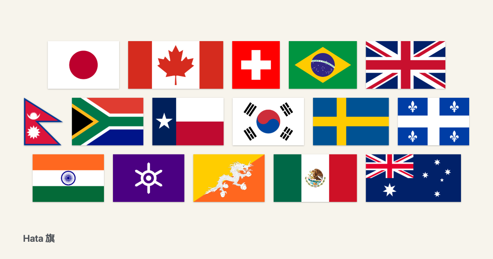
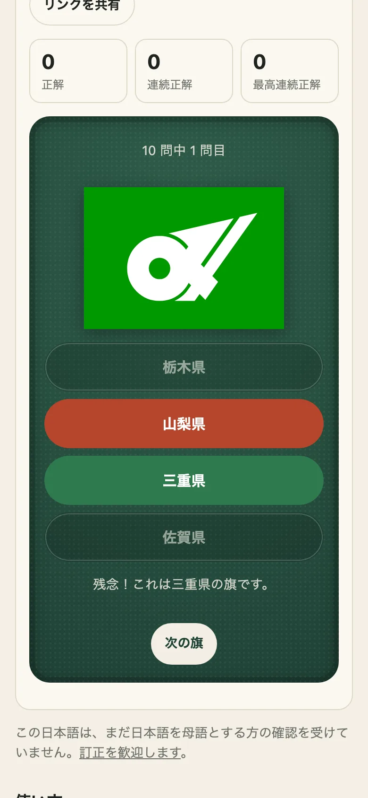
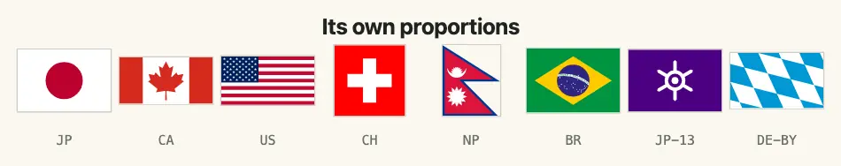
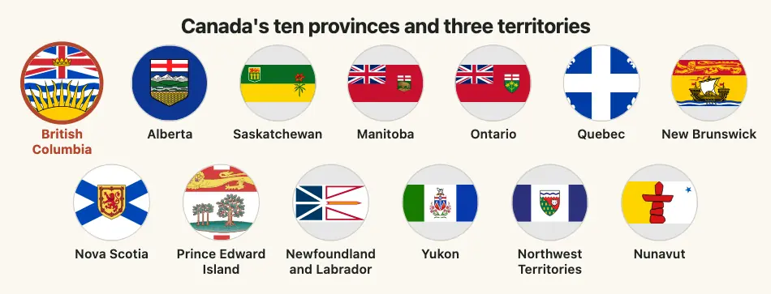
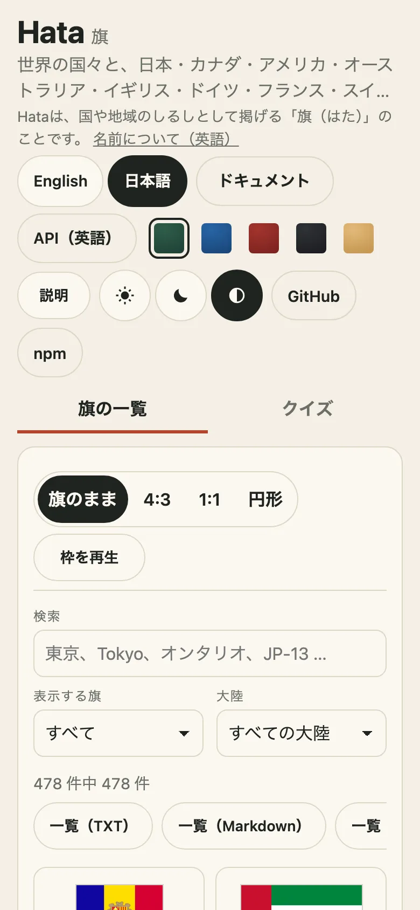
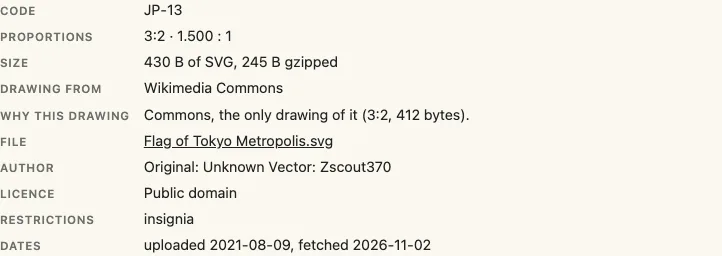

<p align="center"><a href="https://johnmorrisdotca.github.io/hata/"><picture><source media="(prefers-color-scheme: dark)" srcset="https://raw.githubusercontent.com/johnmorrisdotca/hata/main/docs/images/thumbnail-dark.png"></picture></a></p>

<h1 align="center">Hata <sub>旗</sub> — Country and region flags as SVG</h1>

<p align="center"><strong>Hata 旗: flags as SVG for every country, and the regions of Japan, Canada, the United States, Australia, the United Kingdom, Germany, France, Switzerland, Austria and Brazil, keyed by ISO 3166 code.</strong><br>
At their true proportions, with the source, author and licence of every flag. One module per flag, a lookup by code, frames that never stretch a flag, and a <code>&lt;hata-flag&gt;</code> element. Zero dependencies.</p>

<p align="center" lang="ja">世界の国々と、日本・カナダ・アメリカ・オーストラリア・イギリス・ドイツ・フランス・スイス・オーストリア・ブラジルの地域の旗を、本来の縦横比の SVG で収録し、ISO 3166 のコードで引けるようにした、依存関係のない TypeScript パッケージです。</p>

<p align="center">
  <a href="https://github.com/johnmorrisdotca/hata/actions/workflows/ci.yml"></a>
  <a href="https://www.npmjs.com/package/@johnmorrisdotca/hata"></a>
  <a href="./LICENSE"></a>
  
  <a href="https://johnmorrisdotca.github.io/hata/docs/api/main/index.html"></a>
  
  <a href="https://www.npmjs.com/package/@johnmorrisdotca/hata#provenance"></a>
</p>

<p align="center"><a href="https://johnmorrisdotca.github.io/hata/"><strong>Try it →</strong></a> · <a href="https://johnmorrisdotca.github.io/hata/builder.html">Build a flag</a> · <a href="https://johnmorrisdotca.github.io/hata/codes.html">Every code</a> · <a href="https://johnmorrisdotca.github.io/hata/docs/index.html">Documentation</a> · <a href="https://johnmorrisdotca.github.io/hata/docs/guides/getting-started.html">Getting started</a> · <a href="https://johnmorrisdotca.github.io/hata/api.html">API reference</a></p>

<table align="center">
<tr>
<td align="center" valign="top">
<picture>
<source media="(prefers-color-scheme: dark)" srcset="https://raw.githubusercontent.com/johnmorrisdotca/hata/main/docs/images/hero-desk-dark.webp">

</picture>
<br><em>The gallery on a desk: every flag at its own proportions, found by name or code.</em>
</td>
<td align="center" valign="top">
<picture>
<source media="(prefers-color-scheme: dark)" srcset="https://raw.githubusercontent.com/johnmorrisdotca/hata/main/docs/images/quiz-phone-dark.webp">

</picture>
<br><em>The quiz on a phone, in Japanese, after a wrong answer.</em>
</td>
</tr>
</table>

Hata is the flag set a site that already knows its countries and regions by ISO code (from [Kuni](https://github.com/johnmorrisdotca/kuni), say) can show beside them: 519 flags, each drawn at the proportions its government gives it, as an SVG that scales to any size, with its source, author and licence. It works in [the demo](https://johnmorrisdotca.github.io/hata/) with nothing to install. [Why Hata, and what is in it](./docs/guides/what-is-in-hata.md).

## In 30 seconds

```sh
npm install @johnmorrisdotca/hata
```

```ts
import japan from "@johnmorrisdotca/hata/flags/jp";     // one flag, one module: 158 bytes
import { flag } from "@johnmorrisdotca/hata/load";

element.innerHTML = japan;                             // an <svg> with a viewBox: it fills its box, never stretched
const tokyo = await flag("JP-13");                     // any flag by its code, loaded when asked
const round = await flag("ca", { shape: "round", label: "Canada" }); // drawn for the circle, red bars and all
await flag("XX");                                      // null: not a code with a flag
```

```html
<script type="module" src="https://cdn.jsdelivr.net/npm/@johnmorrisdotca/hata@1/dist/element-define.js"></script>
<hata-flag code="DE-BY" shape="round" size="48"></hata-flag>
```

Install the scoped name: an unscoped `hata` on npm is somebody else's package.

## Who it is for

- **Forms and profiles** that show where somebody is from.
- **Sites rendered on a server**, which need a flag as a string, with no network and no DOM.
- **Japanese-language sites** that need the 47 prefectures' flags, and Canadian, American, Australian, British,
  German, French, Swiss, Austrian and Brazilian ones that need their regions' flags, keyed the same way as their
  countries.
- **Any page at all**, with one script tag and a `<hata-flag>`, or an iframe.
- **Maps, quizzes and games**, with flags as square tiles or round markers, never stretched.
- **Anybody who has to say where a picture came from**: every flag has its source, author and licence in the manifest.

## The best of it

- **Round and square frames that never stretch a flag.** `frame()` and `flag(code, { shape })` put a flag in a 4:3, square or round frame, cropped only where a crop keeps every colour, and drawn again for the shape where flag-icons has done so ([frames](./docs/guides/frames-whole-and-cropped.md)).

<p align="center">
<picture>
<source media="(prefers-color-scheme: dark)" srcset="https://raw.githubusercontent.com/johnmorrisdotca/hata/main/docs/images/frames-live-desk-dark.webp">

</picture>
<br><em>Flags through the frames: their own proportions, 4:3, square and round, never stretched.</em>
</p>

- **Every province and territory of Canada**, and the regions of nine other countries: 13 of 13 here, keyed by ISO 3166-2 (`CA-BC`, `CA-ON`).

<p align="center">
<picture>
<source media="(prefers-color-scheme: dark)" srcset="https://raw.githubusercontent.com/johnmorrisdotca/hata/main/docs/images/provinces-desk-dark.webp">

</picture>
<br><em>Canada's thirteen, in round frames, each loaded by its code.</em>
</p>

- **Former countries that a medal table still names**: the Soviet Union, East and West Germany, Czechoslovakia, Yugoslavia and seven more, with their years ([disputed, former and historic flags](./docs/guides/places-with-more-than-one-flag.md#former-countries)).

<p align="center">
<picture>
<source media="(prefers-color-scheme: dark)" srcset="https://raw.githubusercontent.com/johnmorrisdotca/hata/main/docs/images/former-desk-dark.webp">

</picture>
<br><em>Twelve countries that no longer exist, each under a code no present-day country uses.</em>
</p>

- **`<hata-flag>`, one tag in any page**: change `code`, `shape` or `size` and the flag follows, with no framework and no bundler ([the element](./docs/guides/embed-element-and-builder.md)).

<p align="center">
<picture>
<source media="(prefers-color-scheme: dark)" srcset="https://raw.githubusercontent.com/johnmorrisdotca/hata/main/docs/images/element-desk-dark.webp">

</picture>
<br><em>The same tag with a different code and shape.</em>
</p>

## Features

<picture>
<source media="(prefers-color-scheme: dark)" srcset="https://raw.githubusercontent.com/johnmorrisdotca/hata/main/docs/images/hero-phone-dark.webp">

</picture>
<br><em>The gallery header and filters on a phone, in Japanese.</em>

<picture>
  <source media="(prefers-color-scheme: dark)" srcset="https://raw.githubusercontent.com/johnmorrisdotca/hata/main/docs/images/detail-desk-dark.webp">
  
</picture>
<br><em>Tokyo’s detail panel keeps the drawing, frames and source together.</em>

<picture>
  <source media="(prefers-color-scheme: dark)" srcset="https://raw.githubusercontent.com/johnmorrisdotca/hata/main/docs/images/frames-desk-dark.webp">
  
</picture>
<br><em>Compare whole and cropped views at each supported frame shape.</em>

<picture>
  <source media="(prefers-color-scheme: dark)" srcset="https://raw.githubusercontent.com/johnmorrisdotca/hata/main/docs/images/provenance-desk-dark.webp">
  
</picture>
<br><em>Read the stored source, author, licence and drawing proportions.</em>

### What's in it

- **519 flags**: 246 of the 250 countries Kuni knows, 45 of Japan's 47 prefectures,
  13 of Canada's 13 provinces and territories, 57 of the United States' 57 states, district and outlying areas,
  8 of Australia's 8 states and territories, 3 of the United Kingdom's 4 countries, 16 of Germany's 16 states,
  17 of France's 26 regions and overseas collectivities, 26 of Switzerland's 26 cantons, 9 of Austria's 9 states
  and 27 of Brazil's 27 states and Federal District, and 52 former countries that a medal table or a record book
  still names (the Soviet Union, East and West Germany, Czechoslovakia, Yugoslavia, Austria-Hungary, the Ottoman Empire, Prussia, the Kingdom of Hawaii
  and 44 more, every ISO 3166-3 code that has a flag among them: [former countries](./docs/guides/former-countries.md)). The 35 codes with no flag are listed with their reasons.
- **Disputed and alternative flags**, side by side, each with a status, dates and a source; Hata takes no side ([disputed, former and historic flags](./docs/guides/places-with-more-than-one-flag.md)).
- **True proportions, and frames that keep the flag**: 4:3, square and round, whole or cropped where a crop keeps every colour ([frames](./docs/guides/frames-whole-and-cropped.md)).
- **Embed it anywhere**: `<hata-flag>`, an iframe page, and a builder that writes the code ([the element, the iframe and the builder](./docs/guides/embed-element-and-builder.md)).
- **Provenance for every flag**, small where it matters, safe to inline, typed, with no dependencies, no network and no DOM.

Every point in full: [what is in Hata](./docs/guides/what-is-in-hata.md); how a drawing is chosen and what each set weighs: [sources, sizes and limits](./docs/guides/sources-sizes-and-limits.md).

## Use it in your project

The [flag builder](https://johnmorrisdotca.github.io/hata/builder.html) previews each choice and writes code for custom elements, images, iframes, framework components and website code blocks. Its link preserves the setup. See [embedding flags](./docs/embeds.md) for sizes, validated iframe parameters and event messages.

### Install

```sh
npm install @johnmorrisdotca/hata
# or: pnpm add @johnmorrisdotca/hata
# or: yarn add @johnmorrisdotca/hata
```

It ships ES modules with types; nothing has a side effect but `/element/define`, which registers `<hata-flag>`.
Node 24 can also `require()` it.

### Install under another name

```sh
npm install flags@npm:@johnmorrisdotca/hata
```

```ts no-check
import { flagCode } from "flags";
console.log(flagCode("jp-13"));
```

The alias changes only the import name in your project.

### The entry points

| Entry | What it carries | Size |
| --- | --- | --- |
| `@johnmorrisdotca/hata` | The codes, `flagCode`, `flagUrl`, `frame`, `aspectOf`, `toDataUri`; no flag | 13 KB, 4.5 KB gzipped |
| `@johnmorrisdotca/hata/flags/<code>` | One flag's SVG string (`/flags/jp`, `/flags/jp-13`, `/flags/ca-on`, `/flags/de-by`, and a former country's, `/flags/suhh`, lower case); `/flags/<code>.1x1` and `.4x3`, flag-icons' drawing made for that frame, where there is one | median 755 bytes; 176 bytes for Japan |
| `@johnmorrisdotca/hata/load` | `flag(code, { shape, fit, variant, date, role })`, one dynamic import per flag | 26 KB, 5.7 KB gzipped, then the flag's own file (and a 3.6 KB gzipped table when a frame is asked for, and a 0.5 KB one when a variant is) |
| `@johnmorrisdotca/hata/names` | `flagName(code, lang)` and `flagAspect(code)`: each flag's place in English and Japanese, from Kuni | 24 KB, 8.7 KB gzipped |
| `@johnmorrisdotca/hata/signals` | The International Code of Signals' 40 ship signal flags (`ics:`) and 18 of the US Navy's special pennants (`usn:`), with their meanings in English and Japanese | 91 KB, 8.6 KB gzipped, the records only; a drawing is its own file, loaded when asked for |
| `@johnmorrisdotca/hata/signals/<code>` | One drawing's SVG string (`/signals/a`), the module the entry loads for `ics:a`; the restricted ones only by name | median 324 B, at most 500 B |
| `@johnmorrisdotca/hata/samurai` | Sixty-nine battle banners of Sengoku and early Edo daimyo (nobori, hata, uma-jirushi), by `samurai:` id: nine reconstructed from words, sixty drawn from the handscroll 御馬印 (National Diet Library), each saying what is documented and what is reconstruction | 135 KB, 15 KB gzipped, the records only; a drawing is its own file, loaded when asked for |
| `@johnmorrisdotca/hata/samurai/<code>` | One drawing's SVG string (`/samurai/ii-igeta`), the module the entry loads for `samurai:ii-igeta`; the restricted ones only by name | median 388 B, at most 4.8 KB |
| `@johnmorrisdotca/hata/medieval` | 42 medieval banners (six drawn for this package, 36 Wikimedia Commons drawings in the public domain or CC0), by `med:` id, each with its dates, source, file and licence | 83 KB, 12 KB gzipped, the records only; a drawing is its own file, loaded when asked for |
| `@johnmorrisdotca/hata/medieval/<code>` | One drawing's SVG string (`/medieval/red-cross`), the module the entry loads for `med:red-cross`; the restricted ones only by name | median 1.6 KB, at most 110 KB |
| `@johnmorrisdotca/hata/military` | 60 naval ensigns, jacks and war flags of more than thirty navies (Japan's Rising Sun Flag only here, as two ensigns), by `mil:` id, with dates, sources, licences and authors; the Confederate battle flags withheld by default | 99 KB, 11 KB gzipped, the records only; a drawing is its own file, loaded when asked for |
| `@johnmorrisdotca/hata/military/<code>` | One drawing's SVG string (`/military/gb-white-ensign`), the module the entry loads for `mil:gb-white-ensign`; the restricted ones only by name | median 1.5 KB, at most 134 KB |
| `@johnmorrisdotca/hata/organisations` | Organisations' flags (the European Union's and six taken from Commons), by `org:` id | 7.4 KB, 2.5 KB gzipped: the records and the European Union\'s drawing; the others are their own files, loaded when asked for |
| `@johnmorrisdotca/hata/organisations/<code>` | One drawing's SVG string (`/organisations/eu`), the module the entry loads for `org:eu`; the restricted ones only by name | median 885 B, at most 40 KB |
| `@johnmorrisdotca/hata/search` | Each flag's colours (`coloursOf`) and tags (`tagsOf`), and the flags that have them (`flagsWith`) | 67 KB, 21 KB gzipped |
| `@johnmorrisdotca/hata/custom` | Flags the page registers (`custom:<slug>`) | 11 KB |
| `@johnmorrisdotca/hata/element` | `<hata-flag>`: `defineFlag`, `FLAG_ELEMENT_NAME`, `FLAG_ELEMENT_ATTRIBUTES` | 8 KB, 2.8 KB gzipped, then /load and /names |
| `@johnmorrisdotca/hata/element/define` | Registers `<hata-flag>` when imported (`dist/element-define.js` on a CDN) | a line, then /element |
| `@johnmorrisdotca/hata/manifest` | Every flag's source, licence, author and why it was chosen, how each frame is made, the flags in real use besides and the earlier flags of a country (`variantsOf`, `variantOn`), and the codes with no flag | 1,185 KB, 151 KB gzipped |
| `@johnmorrisdotca/hata/svg/<code>.svg` | Every flag as a file, for an `&lt;img&gt;`, a CSS `url()` or a CDN; `<code>.1x1.svg` and `.4x3.svg` too | the same as the module's string |
| `@johnmorrisdotca/hata/manifest.json` | The manifest as JSON | 848 KB |

### 1. One flag

```ts
import japan from "@johnmorrisdotca/hata/flags/jp";
import { svg as tokyo } from "@johnmorrisdotca/hata/flags/jp-13";
import bavaria from "@johnmorrisdotca/hata/flags/de-by";

element.innerHTML = japan;
```

Each flag's types carry a doc comment naming the place, its proportions, its size and its source, so an editor
shows which flag an import is.

### 2. Any flag by its code

```ts
import { flag, flagDataUri } from "@johnmorrisdotca/hata/load";

const svg = await flag(form.country);              // "JP", "jp", "JP-13", "ca_on": any case
image.src = (await flagDataUri("US-TX")) ?? "";    // ready for an image element
```

A code with no flag here, a malformed one, or anything that is not a code gives `null`, never a near miss. Only an
argument that is not a string throws.

### 3. Frames that never stretch, and never misrepresent

```ts
import { frame } from "@johnmorrisdotca/hata";
import canada from "@johnmorrisdotca/hata/flags/ca";
import { flag } from "@johnmorrisdotca/hata/load";

await flag("CA", { shape: "1:1" });                // flag-icons' square of Canada, drawn for the shape
frame(canada, { shape: "round", label: "Canada" }); // the whole flag on a neutral disc, with role="img" and a title
await flag("US", { shape: "1:1", fit: "crop" });   // the canton and a slice of the stripes, not the middle stripes
```

Every flag is offered whole and cropped, at 4:3, square and round, and a crop is kept only where it shows the flag fairly. [Whole and cropped, and how each frame is measured](./docs/guides/frames-whole-and-cropped.md).

### 4. Embed it anywhere

One script tag and an element, for any page:

```html
<script type="module" src="https://cdn.jsdelivr.net/npm/@johnmorrisdotca/hata@1/dist/element-define.js"></script>
<p>Where I live: <hata-flag code="CA-BC"></hata-flag> British Columbia</p>
<hata-flag code="JP-13" shape="round" size="48" border shadow></hata-flag>
```

`code`, `shape`, `size`, `variant`, `date`, `fit`, `label`, `lang`, `theme`, `border`, `shadow` and `loading` are attributes and properties. The table of them, the iframe for a site that allows no scripts, the framework notes and the **Embed this flag** builder are in [the element, the iframe and the builder](./docs/guides/embed-element-and-builder.md).

### Disputed, former and historic flags

A place with more than one flag in real use has them all, each with a status, and Hata takes no side. 52 former countries have flags under codes no present-day country uses, and 35 countries have earlier flags, found by date.

```ts
import { flag } from "@johnmorrisdotca/hata/load";

await flag("AF", { variant: "de-facto" });             // the Taliban's flag; flag("AF") is the Republic's tricolour
await flag("URS");                                     // the Soviet Union (also "SU", "SUHH")
await flag("CA", { date: "1962-09-29", role: "in-use" }); // the Red Ensign, flown that day
```

[Disputed, former and historic flags](./docs/guides/places-with-more-than-one-flag.md) has the variants, the codes, the dates and the reasons.

### 5. An `&lt;img&gt;`, from the CDN or your own folder

```ts
import { flagUrl, toDataUri } from "@johnmorrisdotca/hata";

flagUrl("JP-13");                       // "https://cdn.jsdelivr.net/npm/@johnmorrisdotca/hata@1/dist/svg/jp-13.svg"
flagUrl("US-TX", { base: "/flags" });   // "/flags/us-tx.svg", for a copy of dist/svg/ in your own site
toDataUri(svg);                         // "data:image/svg+xml,…", smaller than base64
```

### 6. Where a flag comes from

```ts
import { leftOut, manifest } from "@johnmorrisdotca/hata/manifest";

manifest("JP-13");   // { source: "commons", file: "Flag of Tokyo Metropolis.svg", licence: { kind: "public-domain", … }, author, why, … }
manifest("YE")?.why; // why country-flag-icons' drawing was chosen over Commons'
manifest("CA")?.framings["1:1"]; // { method: "adapted", fit: "contain", source: "flag-icons", coverLoses: ["red 65% to 29%"], … }
leftOut("EH");       // { kind: "no-flag", reason: "Western Sahara has no flag of its own on Wikidata …" }
```

### 7. Names, for a caption or a screen reader

```ts
import { flagAspect, flagName } from "@johnmorrisdotca/hata/names";

flagName("DE-BY");        // "Bavaria"
flagName("DE-BY", "ja");  // "バイエルン自由州"
flagAspect("CH");         // 1: Switzerland's flag is square
```

### In a page, with no bundler

[Read the complete original HTML image recipe](./docs/guides/loading-flags.md#original-html-image-recipes).

## Every way to use it

The [demo](https://johnmorrisdotca.github.io/hata/), the [docs](https://johnmorrisdotca.github.io/hata/docs/) (English and Japanese) and the [embed page](https://johnmorrisdotca.github.io/hata/embed.html). Each way below is a tested file in [`examples/`](./examples) (`pnpm test:usage`).

Guides: [script tag](./docs/guides/html-and-cdn.md), [Vite and webpack](./docs/guides/bundlers.md), [React, Vue, Svelte, Angular](./docs/guides/frameworks.md), [iframe](./docs/guides/embed-in-an-iframe.md), [TypeScript and Node](./docs/guides/typescript-and-node.md), [the element and the builder](./docs/guides/embed-element-and-builder.md), [frames](./docs/guides/frames-whole-and-cropped.md), [disputed, former and historic flags](./docs/guides/places-with-more-than-one-flag.md).

About the set: [what is in Hata](./docs/guides/what-is-in-hata.md), [sources, sizes and limits](./docs/guides/sources-sizes-and-limits.md), [formats, sizes and licences](./docs/guides/formats-and-licences.md), [Hata and the other flag sets](./docs/guides/other-flag-sets.md) and [moving to Hata from another set](./docs/guides/moving-to-hata.md).

## Examples

### A country select with flags, from Kuni

```ts
import { countries } from "@johnmorrisdotca/kuni";
import { flagUrl } from "@johnmorrisdotca/hata";

const options = countries({ order: "ja" }).map((one) => ({ value: one.alpha2, label: one.name.ja, flag: flagUrl(one.alpha2) }));
// flag is null for the few places with no flag here: draw the name alone
```

### Square tiles and round markers, in CSS

A flag's SVG file in an `&lt;img&gt;` behaves like any picture, so CSS frames it without stretching it too. Use
`manifest(code).framings` to frame it as the package does: the `.1x1.svg` or `.4x3.svg` file where the method is
`adapted`, `object-fit: contain` where the fit is `contain`, and `cover` otherwise, with `object-position: left` (or
`right`) where the fit is `crop` and `crop.at` says so.

```css
.tile img { width: 48px; height: 36px; object-fit: cover; }                       /* 4:3 */
.marker img { width: 32px; height: 32px; object-fit: cover; border-radius: 50%; } /* round */
.marker img.whole { object-fit: contain; background: #e6e6e6; }                   /* where a crop would lose a colour */
```

### A credits page

```ts
import { MANIFEST } from "@johnmorrisdotca/hata/manifest";

const credits = MANIFEST.filter((one) => one.sameAs === null && one.attributionRequired)
  .map((one) => `${one.code}: ${one.file}, ${one.author}, ${one.licence.name}`);
```

### React, Vue and Svelte components

Typed components draw the SVG inline, so the flag is in a server render and a static build. They take the element's props (`code`, `shape`, `size`, `label`, `date`, `variant` and the rest).
React, Vue and Svelte are optional peer dependencies: nothing new is installed for anyone who does not import one.

```jsx
import { Flag, preloadFlags } from "@johnmorrisdotca/hata/react"; // /vue, /svelte and /react-native work the same way
await preloadFlags([{ code: "JP", label: "Japan" }]); // a server's renderToString cannot wait
export const Japan = () => <Flag code="JP" label="Japan" />;
```

```vue
<script setup>import { Flag } from "@johnmorrisdotca/hata/vue";</script>
<template><Flag code="CA" label="Canada" /></template>
```

```svelte
<script>import Flag from "@johnmorrisdotca/hata/svelte";</script>
<Flag code="JP-13" label="Tokyo" />
```

[The frameworks guide](./docs/guides/frameworks.md) has server rendering, hydration, and the element for any other framework.

## API

Read the [complete API reference](https://johnmorrisdotca.github.io/hata/docs/index.html), including typed imports, parameters, missing results and checked examples. The [drawing catalogue](./docs/guides/flag-resources.md) names all fixed modules; existing wildcard imports remain available.

The [API reference](https://johnmorrisdotca.github.io/hata/api.html) lists every export of every entry point with its signature, its parameters, what it returns and an example. It is made from the source by `pnpm site`, so it cannot fall behind the code, and `pnpm check` fails if an export has no summary, no example, or a parameter it does not describe.

| Entry | Exports |
| --- | --- |
| `@johnmorrisdotca/hata` | `FLAG_CODES`, `FLAG_ALIASES`, `isFlagCode`, `flagCode`, `flagUrl`, `aspectOf`, `frame`, `toDataUri`, `VERSION`, and the types `FlagCode`, `FlagUrlOptions`, `FrameOptions`, `Shape` and `Fit` |
| `@johnmorrisdotca/hata/flags/<code>` | the flag's SVG string as the default export and as `svg` |
| `@johnmorrisdotca/hata/load` | `flag`, `flagDataUri`, `flagOn` and the types `FlagOptions`, `FrameOptions` and `LoadedFlagOn` |
| `@johnmorrisdotca/hata/names` | `flagName`, `flagAspect` and the type `NameLanguage` |
| `@johnmorrisdotca/hata/signals` | `SIGNAL_IDS`, `isSignalId`, `signalId`, `signalFlag`, `signalName`, `signalMeaning`, `signalAspect`, `signalInfo`, `signalsFor`, types `SignalId`, `SignalInfo` |
| `@johnmorrisdotca/hata/samurai` | `SAMURAI_IDS`, `isSamuraiId`, `samuraiId`, `samuraiFlag`, `samuraiName`, `samuraiAbout`, `samuraiAspect`, `samuraiInfo`, `samuraiIn`, types `SamuraiId`, `SamuraiInfo` |
| `@johnmorrisdotca/hata/medieval` | `MEDIEVAL_IDS`, `isMedievalId`, `medievalId`, `medievalFlag`, `medievalName`, `medievalAbout`, `medievalAspect`, `medievalInfo`, `medievalIn`, types `MedievalId`, `MedievalInfo` |
| `@johnmorrisdotca/hata/military` | `MILITARY_IDS`, `MILITARY_RESTRICTED_IDS`, `isMilitaryId`, `militaryId`, `militaryFlag`, `militaryName`, `militaryAbout`, `militaryAspect`, `militaryInfo`, `militaryIn`, types `MilitaryId`, `MilitaryInfo`, `MilitaryRestriction` |
| `@johnmorrisdotca/hata/organisations` | `ORGANISATION_IDS`, `isOrganisationId`, `organisationId`, `organisationFlag`, `organisationName`, `organisationAspect`, `loadOrganisationFlag`, `organisationSource`, `organisationTerms`, type `OrganisationId` |
| `@johnmorrisdotca/hata/search` | `COLOUR_NAMES`, `coloursOf`, `FLAG_TAGS`, `TAG_SOURCES`, `tagsOf`, `flagsWith`, and their types |
| `@johnmorrisdotca/hata/custom` | `registerFlags`, `removeFlags`, `enableFlags`, `customFlag`, `customName`, `customAspect`, `customId`, `isCustomId`, `listCustomFlags`, `customGroups`, `searchCustomFlags`, `customCreditLine`, `CUSTOM_GROUP`, `MAX_CUSTOM_FLAGS` |
| `@johnmorrisdotca/hata/element` | `defineFlag`, `FLAG_ELEMENT_NAME`, `FLAG_ELEMENT_ATTRIBUTES`, and the types `HataFlagElement` and `FlagElementEventDetail` |
| `@johnmorrisdotca/hata/element/define` | `defineFlag`, after registering `<hata-flag>` |
| `@johnmorrisdotca/hata/react` | `Flag`, `preloadFlags`, `useFlag`: a component that draws the flag's SVG inline |
| `@johnmorrisdotca/hata/vue` | `Flag` and `preloadFlags` |
| `@johnmorrisdotca/hata/svelte` | the default export, `Flag` (a `.svelte` file) |
| `@johnmorrisdotca/hata/react-native` | `createFlag(SvgXml)` and `preloadFlags`, over react-native-svg |
| `@johnmorrisdotca/hata/bind` | `resolveFlag`, `preloadFlags`, `cachedFlag`, `boxStyle`, `inlineSvg`, `styleText`, and the types `FlagProps` and `BoundFlag` |
| `@johnmorrisdotca/hata/manifest` | `MANIFEST`, `LEFT_OUT`, `RESTRICTED`, `manifest`, `leftOut`, `variantsOf`, `variantOn`, `flagOn`, and the types `FlagRecord`, `Framing`, `FramingCrop`, `LeftOutRecord`, `LicenceKind`, `FlagSource`, `Variant`, `FlagRole`, `RoleNote`, `Restricted`, `RestrictedVariant`, `DatedVariant`, `OtherFlag`, `NoFlag`, `FlagOnDay`, `VariantOptions`, `FlagColour` and `ColourName` |

A flag's record, field by field, is in [sources, sizes, limits and the flag record](./docs/guides/sources-sizes-and-limits.md#a-flags-record). Every function is pure and every record it hands out is frozen.

## Theming

A flag is its government's colours, so there is nothing to theme in it. What a page chooses is the frame: its
shape (`flag(code, { shape })`, `frame()` or CSS `object-fit`), a border or a shadow for a white flag on a white page
(`<hata-flag border shadow theme="dark">`, and its three CSS custom properties), and its size. The demo is the worked example:
[`demo/demo.js`](./demo/demo.js) and [`demo/hata.css`](./demo/hata.css).

## Limits

246 of the 250 countries Kuni knows; the first level of ten countries' subdivisions; 52 former countries; 35 codes with a reason and no flag (`LEFT_OUT`); only public domain, CC0, CC BY and MIT drawings; and the largest flag is 372 KB (Virginia), with 55 over the 40 KB budget. Not here: other countries' regions, the United Kingdom's counties, cities, ensigns, standards and raster pictures. A flag's licence covers the drawing; using a country's flag or seal may still be limited by its law, which [NOTICE.md](./NOTICE.md) explains. The table is in [sources, sizes and limits](./docs/guides/sources-sizes-and-limits.md#limits).

## Accessibility

A flag is a picture, so what Hata can do is make it easy to name.

- **A label on request.** `frame(svg, { label })` and `flag(code, { label })` give the SVG `role="img"`, an
  `aria-label` and a `<title>`; an `&lt;img&gt;` takes the place's name as its `alt`.
- **Named by default in the element.** `<hata-flag>` is `role="img"` with the place's name from Kuni as its
  `aria-label`, in English or Japanese by the page's language, unless `label` says otherwise; a code with no flag
  leaves no unnamed picture behind.
- **A frame that does not mislead.** A square or round flag never drops the colours that make it the flag.
- **Never the only label.** The demo always writes the name beside a flag, in the page's language.
- **In the demo**, every control is at least 44 pixels square, the fields do not zoom on a phone, the detail
  panel is a modal dialog that Escape closes, and the page fits a phone at 390 pixels with no sideways scroll.
- **Not yet.** The demo's colours have not been measured against WCAG contrast ratios, and its Japanese has not
  been read by a native reader (see [Languages](#languages)).

## Browser and runtime support

The package is strings and plain functions, so it runs anywhere JavaScript does: any current browser and Node. The
SVG files work in every browser that shows SVG. Building it needs Node 24 or later; CI tests on Linux, macOS and Windows,
and the demo is played in Chromium at a phone's width and a desk's, and in WebKit at a phone's.

## Languages

The package itself has no words: its codes and SVG are the same in every language, and the manifest's reasons are in
English as their sources give them. The demo speaks English and Japanese, with the places' names from Kuni.
**Japanese: included; not yet reviewed by a native reader. Corrections welcome.** Every line of the demo is listed beside its English in
[docs/strings-ja.md](./docs/strings-ja.md), and there is an [issue template](https://github.com/johnmorrisdotca/hata/issues/new?template=fix-a-translation.md) for fixing one.

## Roadmap

Not here yet; each is welcome as an [issue](https://github.com/johnmorrisdotca/hata/issues):

- More countries' regions, a whole country at a time: Spain and Italy once their drawings are free, Mexico and India for states with an official flag.
- The four flags left out for their licence ([decisions](./docs/decisions.md)).
- A simplified drawing of the heaviest seals, beside the full one.
- Dated earlier flags for the countries not yet researched ([docs/decisions.md](./docs/decisions.md#historic-flags-of-present-day-countries)).

Not planned: redrawn flags, anything share-alike or GPL, and Angular or Solid components (the element works there).

## Architecture

The root keeps codes and pure SVG helpers separate from lazy loading, names, provenance and the optional element. The [complete original source tree and generation boundaries](./docs/guides/architecture.md) are preserved in the architecture guide.

## Data and licences

| What | From | Licence |
| --- | --- | --- |
| Which file is each place's flag | Wikidata, a snapshot of 2026-10-09 | CC0 |
| 462 flags' drawings | Wikimedia Commons, each file's own licence: 450 public domain, 10 CC0, 2 CC BY 2.5 (Saint Barthélemy's one picture, under two codes) | as stated on each file's page |
| Yemen's drawing | country-flag-icons 1.6.20 | MIT |
| The 425 drawings made for a frame | flag-icons 7.5.0 | MIT |
| The drawings compared but not shipped | circle-flags 2.8.3 | MIT |
| The places' names, in the docs, the demo, `/names` and `<hata-flag>` | Kuni 1.1.0 (Unicode CLDR and Wikidata) | MIT, Unicode-3.0, CC0 |
| The pipeline, the frames, the lookups and the demo | written for this package | MIT |

How a drawing is chosen and checked, and what each set weighs: [sources, sizes and limits](./docs/guides/sources-sizes-and-limits.md). [NOTICE.md](./NOTICE.md) carries the credit CC BY asks for, country-flag-icons' and flag-icons' MIT notices, and the note on
insignia, and ships with the package. [data-sources/README.md](./data-sources/README.md) says where every input
came from and how to refresh it.

## The name

*Hata* (旗) is Japanese for "flag": a banner on a pole, as in 国旗 (*kokki*, a national flag), 旗揚げ (*hata-age*,
raising a flag, and so founding something) and 旗印 (*hatajirushi*, the emblem on a samurai's banner, and so a
cause). ([Wiktionary: 旗](https://en.wiktionary.org/wiki/旗), which gives "flag, banner".)

## Where it comes from, and where it is used

Hata was written for [Kuni](https://github.com/johnmorrisdotca/kuni), which showed each country's flag as an
emoji: a picture that cannot be sized, looks different on every system, and is two letters on Windows. A survey of
the flag sets on npm found none with Japan's prefectures, none with all of Canada's provinces and territories, and
none keyed by ISO 3166-2 codes; every one of them draws from Wikimedia Commons, so Hata goes there too, and says
which file each flag is.

### Used by

- **[REST in Pieces](https://github.com/spxis/rest-in-pieces)**, a fake-data REST service, gives every country and region a `flag` link to Hata's SVG and draws `/flags/{code}.svg` (with Hata's shapes, crops and variants) when Hata is installed beside it.

Using Hata in something? Open an *Add my project* issue and we will add you.

### The family

<!-- family:start (made by scripts/family-readme.mjs from scripts/family-template.mjs; change those, not this) -->
Hata is one of forty-one packages, each made for the same site, each at
[github.com/johnmorrisdotca](https://github.com/johnmorrisdotca) or [github.com/spxis](https://github.com/spxis). The code of every one is MIT.

**Games — board**

- [Domino](https://github.com/johnmorrisdotca/domino) (ドミノ): dominoes and Mexican Train. [Demo](https://johnmorrisdotca.github.io/domino/).
- [Gunjin](https://github.com/johnmorrisdotca/gunjin) (軍人): five hidden-rank strategy games with pass-the-device play. [Demo](https://johnmorrisdotca.github.io/gunjin/).
- [Narabe](https://github.com/johnmorrisdotca/narabe) (並べ): one rules engine for abstract board games, from gomoku and Reversi to Go and checkers. [Demo](https://johnmorrisdotca.github.io/narabe/).
- [Sugoroku](https://github.com/johnmorrisdotca/sugoroku) (双六): backgammon and its variants, with the doubling cube and match play. [Demo](https://johnmorrisdotca.github.io/sugoroku/).
- [Tenka](https://github.com/johnmorrisdotca/tenka) (天下): world conquest for two to six, on a map of the real world. [Demo](https://johnmorrisdotca.github.io/tenka/).

**Games — cards & tiles**

- [Fuda Cards](https://github.com/johnmorrisdotca/fuda-cards) (札): collectible card frames with a true thickness, foil, stacks, wear and a binder, as two web components. [Demo](https://johnmorrisdotca.github.io/fuda-cards/).
- [Hitotsu](https://github.com/johnmorrisdotca/hitotsu) (一つ): a colour-card shedding game for two to eight, with the house rules people play. [Demo](https://johnmorrisdotca.github.io/hitotsu/).
- [Jarajara](https://github.com/johnmorrisdotca/jarajara) (ジャラジャラ): mahjong tiles drawn as SVG, stacked layouts, and the matching solitaire Awase. [Demo](https://johnmorrisdotca.github.io/jarajara/).
- [Kumimoji](https://github.com/johnmorrisdotca/kumimoji) (組み文字): a crossword tile race, in English and Japanese kana. [Demo](https://johnmorrisdotca.github.io/kumimoji/).
- [Toranpu](https://github.com/johnmorrisdotca/toranpu) (トランプ): a deck of playing cards, card games with computer players, and solitaires. [Demo](https://johnmorrisdotca.github.io/toranpu/).

**Games — puzzles**

- [Houseki](https://github.com/johnmorrisdotca/houseki) (宝石): gem and stone matching puzzles: falling triplets, stone collapse, colour chains and gem swap. [Demo](https://johnmorrisdotca.github.io/houseki/).
- [Jirai](https://github.com/johnmorrisdotca/jirai) (地雷): minesweeper on shaped grids with verified no-guess boards. [Demo](https://johnmorrisdotca.github.io/jirai/).
- [Karakuri](https://github.com/johnmorrisdotca/karakuri) (からくり): eight hyper-casual puzzle games, some of them physics: draw a shield, pull pins, cut ropes, slide blocks, pour tubes. [Demo](https://johnmorrisdotca.github.io/karakuri/).
- [Kazu](https://github.com/johnmorrisdotca/kazu) (数): grid number puzzles: Sudoku and its variants, Futoshiki and Skyscrapers. [Demo](https://johnmorrisdotca.github.io/kazu/).
- [Kyuubu](https://github.com/johnmorrisdotca/kyuubu) (キューブ): a turning cube for the browser, 2×2 to 7×7, with record solves to replay. [Demo](https://johnmorrisdotca.github.io/kyuubu/).
- [Meikyuu](https://github.com/johnmorrisdotca/meikyuu) (迷宮): mazes on squares, hexagons, triangles and circles, made from a seed and drawn through with a finger or the mouse. [Demo](https://johnmorrisdotca.github.io/meikyuu/).
- [Suido](https://github.com/johnmorrisdotca/suido) (水道): a pipe puzzle: turn the pieces until the water reaches every drain. [Demo](https://johnmorrisdotca.github.io/suido/).
- [Tobiishi](https://github.com/johnmorrisdotca/tobiishi) (飛び石): peg solitaire with nine boards and seeded solvable challenges. [Demo](https://johnmorrisdotca.github.io/tobiishi/).
- [Tsunagi](https://github.com/johnmorrisdotca/tsunagi) (繋ぎ): a line-joining logic puzzle whose every level has exactly one answer. [Demo](https://johnmorrisdotca.github.io/tsunagi/).

**Games — dice & random**

- [Korokoro](https://github.com/johnmorrisdotca/korokoro) (コロコロ): dice, with notation, exact odds, real sounds and the dice of many games. [Demo](https://johnmorrisdotca.github.io/korokoro/).
- [Tane](https://github.com/johnmorrisdotca/tane) (種): seeded random numbers and daily seeds, the same in every browser and on every server. [Demo](https://johnmorrisdotca.github.io/tane/).

**Language**

- [Bushu](https://github.com/johnmorrisdotca/bushu) (部首): find a kanji by the parts it is made of. [Demo](https://johnmorrisdotca.github.io/bushu/).
- [Hikidashi](https://github.com/johnmorrisdotca/hikidashi) (引き出し): a drawer of small Japanese text tools: era dates, kanji numerals, readings and sentence difficulty. [Demo](https://johnmorrisdotca.github.io/hikidashi/).
- [Jisho](https://github.com/johnmorrisdotca/jisho) (辞書): words of Japanese looked up by reading or written form, and the grades, JLPT levels, readings and look-alike pairs of 2,999 kanji. [Demo](https://johnmorrisdotca.github.io/jisho/).
- [Kotoba](https://github.com/johnmorrisdotca/kotoba) (言葉): word lists and word-game rules in English, French, German and Japanese. [Demo](https://johnmorrisdotca.github.io/kotoba/).

**Space Program X**

- [Chikyu Earth](https://github.com/johnmorrisdotca/chikyu-earth) (地球): a line-drawn globe that turns at the Earth's own rate, with an optional realistic Earth from space and markers for any place. [Demo](https://johnmorrisdotca.github.io/chikyu-earth/).
- [Hoshi Stars](https://github.com/johnmorrisdotca/hoshi-stars) (星): the stars you can see without a telescope, with names, colours and distances, the constellations with their lines and boundaries, and the Messier objects, drawn on any of seven sky maps. [Demo](https://johnmorrisdotca.github.io/hoshi-stars/).
- [Uchusen Rockets](https://github.com/johnmorrisdotca/uchusen-rockets) (宇宙船): rockets drawn from sourced sizes, as line drawings and 3D views you can take apart and turn, with a check that a rocket really goes together. [Demo](https://johnmorrisdotca.github.io/uchusen-rockets/).
- [Wakusei Planets](https://github.com/johnmorrisdotca/wakusei-planets) (惑星): the Sun, the planets and their moons, as line drawings, shaded drawings and painted surface maps, with their real sizes, tilt and rotation. [Demo](https://johnmorrisdotca.github.io/wakusei-planets/).

**Geography & data**

- [address-plus](https://github.com/johnmorrisdotca/address-plus) (アドレスプラス): parse and format addresses in the United States, Canada, Japan, Australia, France, Germany and the United Kingdom. [Demo](https://johnmorrisdotca.github.io/address-plus/).
- [Chizu](https://github.com/johnmorrisdotca/chizu) (地図): maps of the world and of countries' regions, in English and Japanese, with a quiz and callouts. [Demo](https://johnmorrisdotca.github.io/chizu/).
- [Hako Devices](https://github.com/johnmorrisdotca/hako-devices) (箱): line drawings and 3D views of computers, phones, consoles and NAS boxes, from published sizes. [Demo](https://johnmorrisdotca.github.io/hako-devices/).
- [Hata](https://github.com/johnmorrisdotca/hata) (旗): country and regional flags as SVG, at their true proportions and keyed by ISO code. [Demo](https://johnmorrisdotca.github.io/hata/).
- [Koyomi Calendars](https://github.com/johnmorrisdotca/koyomi-calendars) (暦): calendar-page icons and whole months as SVG, in light and dark, with page-turning from one day to the next. [Demo](https://johnmorrisdotca.github.io/koyomi-calendars/).
- [Kuni](https://github.com/johnmorrisdotca/kuni) (国): countries and their regions, with ISO codes and names in English and Japanese. [Demo](https://johnmorrisdotca.github.io/kuni/).

**Sports**

- [Dougu Sports](https://github.com/johnmorrisdotca/dougu-sports) (道具): sports emblems as SVG: trophies, medals, crests, and the ball and gear of every sport, with optional 3D turning. [Demo](https://johnmorrisdotca.github.io/dougu-sports/).
- [Kyogijo Stadiums](https://github.com/johnmorrisdotca/kyogijo-stadiums) (競技場): sports fields, rinks, courts and ballparks drawn to scale as SVG, with each team and the score on them. [Demo](https://johnmorrisdotca.github.io/kyogijo-stadiums/).
- [Meigen Sports](https://github.com/johnmorrisdotca/meigen-sports) (名言): sports quotations and on-this-day history. [Demo](https://johnmorrisdotca.github.io/meigen-sports/).
- [Senshu Jerseys](https://github.com/johnmorrisdotca/senshu-jerseys) (選手): sports jerseys, sweaters, kits, caps, helmets and retired-number banners as SVG, front and back, with optional 2.5D turning. [Demo](https://johnmorrisdotca.github.io/senshu-jerseys/).
- [Taisen Brackets](https://github.com/johnmorrisdotca/taisen-brackets) (対戦): a sport-agnostic tournament bracket, drawn as SVG, from a list of ties. [Demo](https://johnmorrisdotca.github.io/taisen-brackets/).

**Developer tools**

- [REST in Pieces](https://github.com/spxis/rest-in-pieces) (レスト・イン・ピーシーズ): seeded test data and REST APIs for frontend development, with latency and error drills. [Demo](https://spxis.github.io/rest-in-pieces/).


**This package is Hata.** The demos of all forty-one share one header and footer, so each links the rest.
<!-- family:end -->

## Development

```sh
pnpm install
pnpm check                # lint, types, build, every export's documentation, tests (sizes included), the packed package
pnpm test:package         # pack, install and import it as somebody who installed it would
pnpm test:demo            # build the demo and play it in a real browser, at a phone's width and a desk's
pnpm site                 # build the demo into site/, as the Pages workflow publishes it
pnpm screenshots:readme   # take the README's pictures from the built demo, in light and dark
pnpm data                 # rebuild src/flags, src/data and the lists in docs/ (no network, no browser)
pnpm data:compare         # draw every shipped flag beside its source, pixel by pixel
pnpm data:choose          # compare the drawings of every flag and choose what ships
pnpm docs:make            # rewrite docs/strings-ja.md after changing a word of the demo
```

## Contributing

See [CONTRIBUTING.md](./CONTRIBUTING.md); the commands are under [Development](#development), and the rules for the flags are in its own section. Please follow the [code of conduct](./CODE_OF_CONDUCT.md). A security concern is for the [security policy](./SECURITY.md), not a public issue.

## Changes

See [CHANGELOG.md](./CHANGELOG.md). The first version is 1.0.0.

## Licence

MIT, © John Morris. The flags are Wikimedia Commons' drawings, each under its own licence (public domain, CC0 or CC BY), and one from country-flag-icons (MIT); Wikidata (CC0) says which. [NOTICE.md](./NOTICE.md), which ships with the package, gives the credits and notices.
